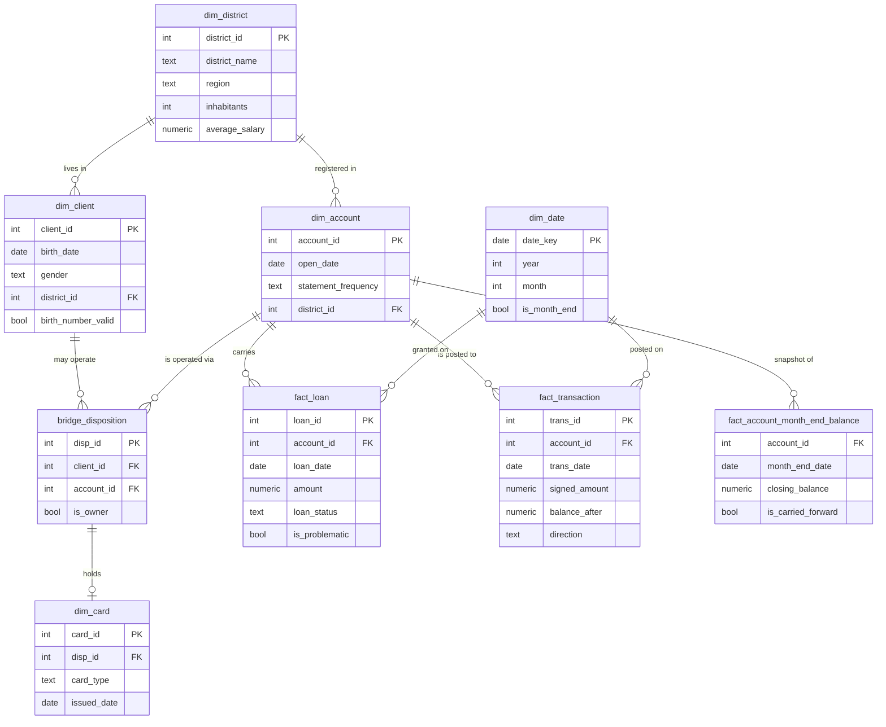

# Data model explanation

Generated by `make model` at 2026-10-25T09:01:39+00:00 (git c1e2ead).
Row counts below are read from the built database, not transcribed.

## Shape: star schema with a bridge, plus curated views

Seven source tables become four dimensions, one bridge, two base facts
and one derived fact, with three curated views on top. The views are
the surface the `ai` schema publishes, so an AI consumer never has to
rediscover a join path that the business already has one answer for.

## Grain, keys and why each object exists

| object | kind | grain (one row per) | key | rows | why this shape |
|---|---|---|---|---:|---|
| `core.dim_date` | dimension | one calendar day | date_key | 2,191 | Lets 'per month in 1996' (Q6) report all twelve months, including any month with no activity, instead of the query having to invent the gaps. |
| `core.dim_district` | dimension | one administrative district | district_id | 77 | Reference data shared by clients and accounts. Holds the region that Q1 groups by, so the region has exactly one definition. |
| `core.dim_client` | dimension | one client | client_id | 5,369 | The entitlement key: access is granted per client, so the client has to be a first-class object rather than an attribute of an account. |
| `core.dim_account` | dimension | one account | account_id | 4,500 | Carries the statement frequency (Q10) and the account's own district (Q5), which is not always the owner's district. |
| `core.bridge_disposition` | bridge | one client-account-capacity triple | disp_id | 5,369 | The client-to-account relationship is many-to-many, and the capacity (OWNER or DISPONENT) is the whole point: collapsing it into either side is what makes 'the account owner' ambiguous. Cards also hang off it. |
| `core.dim_card` | dimension | one issued card | card_id | 892 | A card belongs to a disposition, not to a client, so it reaches a person only through the bridge. Q4 and Q8 depend on that path being explicit. |
| `core.fact_loan` | fact | one loan | loan_id | 682 | Grain is the loan, not the account, so a second loan on one account is representable even though this dataset has none. is_problematic is the certified B-or-D definition used by Q3 and Q10. |
| `core.fact_transaction` | fact | one posting | trans_id | 1,056,319 | signed_amount is pre-computed (credits positive, debits negative) so no consumer re-derives the sign from a Czech type code - the single most likely place for generated SQL to go wrong. |
| `core.fact_account_month_end_balance` | fact (derived) | one account per month end | account_id + month_end_date | 185,615 | 'The balance at the end of December 1998' (Q9) is a modelling decision, not a column: it needs a tie-break for intra-day order and a carry-forward for months with no posting. Both are decided here, once, and marked with is_carried_forward. |
| `core.v_account_owner` | curated view | one account | account_id | 4,500 | The only place that decides what 'the account owner' means. Four questions say the phrase; without this view each generated query would re-invent the join and some would pick a disponent. |
| `core.v_loan_enriched` | curated view | one loan | loan_id | 682 | Answers Q2, Q3, Q4, Q7 and Q10 with no further joins, including the owner's exact age at loan start. |
| `core.v_client_region` | curated view | one client | client_id | 5,369 | Answers Q1 from the client's OWN district, with the choice stated in the view comment rather than left to the query. |

## Join paths

| from | to | path | note |
|---|---|---|---|
| account | its owner | `dim_account -> bridge_disposition (is_owner) -> dim_client` | Exactly one owner per account, enforced by block rule `UNQ_ACCOUNT_SINGLE_OWNER`. |
| account | the owner's card | `... -> bridge_disposition (is_owner) -> dim_card` | A disponent's card must not be attributed to the owner; the join goes through the owner's disposition only. |
| client | region | `dim_client -> dim_district.region` | The client's OWN district. Q1 uses this. |
| account | region | `dim_account -> dim_district.region` | The district the account is registered in. Q5 uses this. The two differ for 9.1 percent of owners. |
| loan | owner, card, frequency | `core.v_loan_enriched` | One row per loan, no fan-out. |
| account | month-end balance | `core.fact_account_month_end_balance` | Pre-computed; carrying forward and tie-breaks are already decided. |

## Which object answers which question

| question | object | why |
|---|---|---|
| Q1 clients per region | `v_client_region` | Region of the client's own district. |
| Q2 loan amount per year | `fact_loan` | `loan_year` is materialised, so no date function in the grouping. |
| Q3 share of problematic loans | `fact_loan.is_problematic` | One certified definition (status B or D). |
| Q4 average loan amount per owner's card type | `v_loan_enriched.owner_card_type` | Owner-only card join; loans whose owner holds no card fall in `no card`. |
| Q5 top districts by incoming amount 1997 | `fact_transaction` + `dim_account` + `dim_district` | `direction = 'credit'` is the certified meaning of incoming. |
| Q6 accounts opened per month 1996 | `dim_account` + `dim_date` | The date dimension supplies the empty months. |
| Q7 average owner age at loan start per status | `v_loan_enriched.owner_age_at_loan_start` | Exact age from date of birth, computed once in the view. |
| Q8 gender split of gold card owners | `v_account_owner` | Owner's own card only, so a disponent's gold card cannot leak in. |
| Q9 average balance at end of December 1998 | `fact_account_month_end_balance` | Month-end grain with carry-forward already applied. |
| Q10 problematic share per statement frequency | `v_loan_enriched.statement_frequency` | Frequency travels with the loan, so no extra join. |

## Alternatives considered

**One big table.** Flatten everything onto the transaction, which is
the shape many text-to-SQL tools prefer because it removes joins. It
was rejected for two reasons. First, the questions have four different
grains (client, account, loan, posting), and a single table at posting
grain makes every count of clients, accounts and loans a
`count(distinct ...)` - which is exactly the construct an LLM gets
wrong quietly. Second, entitlements: the filter belongs on the client,
and in a flattened table the client column repeats 1.06 m times, so a
row level security predicate has to be evaluated per posting instead
of per client. The curated views give the same join-free experience to
the model while keeping the grains honest.

**Data Vault.** Hubs, links and satellites would model the
client-account relationship and its history properly, and it is the
right answer for a bank integrating many source systems. It was
rejected here: there is one source, no history to track (the dataset
is a single 1999 extract), and it would roughly triple the object
count and add a presentation layer on top before a single question
could be answered - the infrastructure-over-substance trap the brief
warns about.

**Keep the source model.** Query `stg` directly and skip `core`.
Rejected because the source model encodes its business meaning in
Czech codes and in a disposition table whose `type` column decides who
the owner is. Every one of the 10 questions would then start by
re-deriving that meaning, and each generated query would be free to
re-derive it differently. The modelling work here is precisely the
work of deciding those things once.

**Surrogate keys.** Not used: the source keys are stable integers, and
at this volume a surrogate layer would add a join per dimension
without adding conformance. What changes at 100,000x is in the Design
Decision Record.

