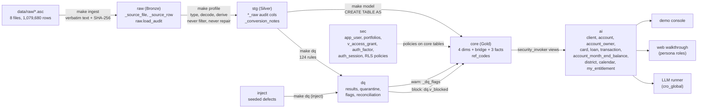
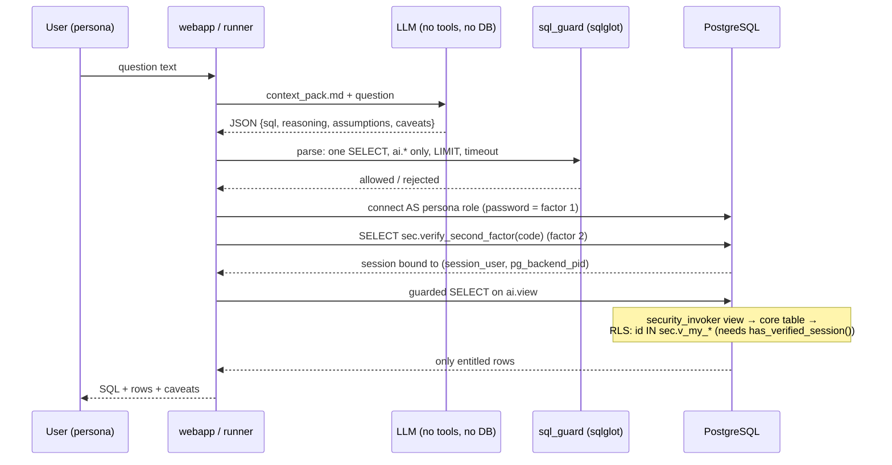

# Interview preparation: Loan-valid-DQ

A technical analysis, a defence plan and a study pack for the 45-minute walkthrough
plus 15 minutes of questions on *The Governed Data Product for AI* (Berka PKDD'99).

This file is the only change this analysis makes. No code, SQL, test, deliverable or
database state was changed. All database work was read-only: `SELECT` statements,
`READ ONLY` transactions, or temporary views inside transactions that were rolled back.

---

## How to read this document

Every claim carries one evidence label:

| Label | Meaning |
|---|---|
| **[RUN]** | Re-run read-only during this analysis (2026-10-26) against the live database. The output is quoted here. |
| **[CODE]** | Checked by reading the source at the cited `path:line`. |
| **[REC]** | Recorded in a committed file (`dq/results/*.json`, `llm_logs/`), or seen in an earlier working session. Not re-run here. |
| **[DOC]** | Appears only in project documentation. Not independently checked. |
| **[DERIVED]** | Worked out by replaying RLS predicates or reasoning about SQL semantics. Not run as the role itself. |
| **[UNVERIFIED]** | Could not be checked. Named as such. |

**State analysed.** Git HEAD `6590bd3` (clean tree before this file). The database was
last rebuilt at `ee65938`: the latest DQ run is `16308448…`, dated 2026-10-26 00:23 UTC.
`git diff ee65938..HEAD` touches no SQL, no rule file, no semantic file and no build
module **[RUN]**, so the database matches the current SQL.

**Environment.** A native PostgreSQL 16 cluster in this container, started with the
idempotent `scripts/db_up.sh`; there is no Docker daemon here. The Docker path was not
exercised **[UNVERIFIED here]**.

---

## 1. Executive summary

**What was built.** A medallion pipeline in PostgreSQL 16 driven by Python:
- **Bronze `raw`:** text kept verbatim, plus a SHA-256 load audit.
- **Silver `stg` + `dq`:** typed and decoded data with lineage. 124 data quality rules
  graded block / warn / info, with quarantine and flags.
- **Gold `core`:** a star schema with a disposition bridge and a derived month-end
  balance fact.
- **`ai`:** `security_invoker` consumer views.
- **`sec`:** row level security keyed on `session_user`, a grant model (ownership,
  disposition, portfolio, delegation) and database-enforced TOTP second factor.

On top sit a validated YAML semantic layer rendered into a context pack, a sandboxed LLM
run, a sqlglot SQL guard, a value-based evaluation, deliverables (workbook, DDR,
55-slide deck, ZIP), a console demo and a web walkthrough.

**Headline verification.** All ten reference answers reproduce exactly from the `raw`
text tables, using SQL written independently of `stg`/`core` **[RUN]** (§6). The LLM
answers match the reference within the 0.011 tolerance **[REC]**. The one visible
difference, Q7 status B (39.61 vs 39.60), is double rounding in `ai.loan`
(`sql/40_ai_views.sql:168`) **[RUN]**.

**What a critical interviewer will find.** Ordered by consequence:

1. **The month-end balance fact is mostly wrong at row level [RUN].** The tie-break
   "latest date, then highest `trans_id`" (`sql/30_core.sql:446-449`) disagrees with the
   balance chain in the source (`balance_after − signed_amount` = previous balance) for
   **154,018 of 185,057** posted account-months (83%).
   - Bank interest postings carry high ids but come *before* the month-end statement fee.
   - Example: account 31, November 1998, is recorded as 13,312.90. After the 14.60 fee
     the true closing balance is 13,298.30.
   - Q9 itself barely moves: 43,808.94 vs 43,810.73 chain-corrected.
   - The project's repeated claim that "no derived table can resolve what the source did
     not record" (`docs/GOLD_LAYER.md:199-200`, `scripts/make_pitch_deck.py:1601-1602`)
     is contradicted. The chain resolves 98.5% of ambiguous account-months.
2. **The 10/10 evaluation is weaker evidence than it looks.**
   - The context pack tells the model which entity answers which question
     (`semantic/context_pack.md:222-226`: "Answers Q2, Q3, Q4, Q7 and Q10 with no further
     joins").
   - There is no hold-out question.
   - The same AI assistant wrote the reference SQL and the semantic layer, yet
     `AI_DISCLOSURE.md:52` labels the reference SQL "Hand written".
   - Each question is compared on one key measure (`src/evaluate.py:66-75`).
3. **Disponent containment is not complete [DERIVED].** Client 3764 operates account
   3112, which client 3763 owns.
   - Through `ai.card` and `core.bridge_disposition`, 3764 can see the owner's card
     (junior, issued 1996-08-05) and client id 3763.
   - Through `ai.loan`, 3764 sees `owner_card_type = 'no card'` and a NULL statement
     frequency: hidden data shown as a false value.
   - Both contradict `docs/ACCESS_AND_AUTH.md:76-79`. The test only checks `ai.client`
     (`tests/test_rls.py:659-679`).
4. **Scope against the brief.**
   - The brief expects 1–2 days and warns that heavy infrastructure work means the brief
     was misread.
   - The repository has TOTP 2FA, a web app, an Oracle/DuckDNS deployment guide, a
     55-slide deck and simulated layer agents.
   - These were built at the stakeholder's explicit request during the engagement, but
     you must be ready to defend them as *governance demonstrations*, not infrastructure.
5. **Documentation drift.**
   - Test counts disagree: 114 (`README.md:9`), 137 (deck), 202 (`GETTING_STARTED.md`),
     against **241 collected [RUN]**.
   - The deck and the DDR were last committed at `31960ab`, five commits before HEAD.
   - `ASSUMPTIONS.md:25` (A10) claims a calendar-year age difference reads about 0.5
     years high. The data shows it within ±0.11 of the exact age; it is *completed* years
     that read about 0.5 low **[RUN]**.
6. **The only blocking defect is a 0.00 CZK posting.**
   - `UNQ_TRANS_BUSINESS_KEY` requires an identical resulting balance
     (`dq/dq_rules.yaml:838-868`), so by construction it can only catch zero-amount
     duplicates.
   - Next to the caught pair, account 9051 shows a duplicated interest run that no rule
     flags.
   - 1,082 (account, date) groups hold repeated identical `UROK` postings worth
     157,289.70 CZK **[RUN]**. Their business meaning is **[UNVERIFIED]**.

**Strengths you can defend.**
- Enforcement sits in the engine (RLS on base tables, `security_invoker` views, identity
  from `session_user`), with roughly nine bypass tests.
- Every cleaning step can be reversed (`_raw` columns, notes).
- Severities carry mechanical consequences.
- Interpretation choices are written down (A1–A16) and reported next to each answer.
- Raw → stg reconciles on rows and money **[RUN]**.
- Seeded defects prove the rules fire **[REC]**.

**Five topics to study first** (detail in §15):
1. The balance tie-break: the defect, its impact, the fix.
2. Evaluation validity and the honesty of the disclosure.
3. Disponent visibility and RLS-induced NULL semantics.
4. Defending scope against the brief.
5. Interpretation sensitivity for Q1, Q4, Q7, Q9 and Q10.

---

## 2. Requirement-to-evidence matrix

| # | Requirement (brief) | Implementation | Evidence | Status | Remaining gap |
|---|---|---|---|---|---|
| R1 | DQ rules covering completeness, uniqueness, RI, validity, cross-table consistency | `dq/dq_rules.yaml` (124 rules), `src/dq_runner.py` | Latest run: completeness 58, validity 26, uniqueness 13, RI 12, consistency 12, reconciliation 3 **[RUN]** | Implemented | 35 of the 58 completeness rules are generated `COMP_NULL__*` checks, so the headline count is padded. The duplicate rule cannot see non-zero duplicates (§4.3). |
| R2 | Report defect types with rule and severity | Workbook tab "Defect types" (14 data rows); `dq/results/dq_report.md` | Workbook read **[RUN]** | Implemented | Workbook built at `a9c9f38` (Overview tab), committed `ee65938` |
| R3 | Justify each severity | `severity_rationale` on each rule; `tests/test_dq.py:55` checks it is present | **[CODE]** | Implemented | A presence test cannot judge whether a rationale is right; see the duplicate rule (§4.3) |
| R4 | Data model on cleaned data | `sql/30_core.sql`: star schema + bridge + derived balance fact | Row counts **[RUN]** (§5) | Implemented | Month-end balance tie-break defect (§4.2) |
| R5 | Semantic solution to guide an AI | `semantic/semantic_layer.yaml` → `semantic/context_pack.md`; validated against `information_schema` (`src/semantic_context.py:46-59`) | **[CODE]** | Implemented | Tuned to the 10 questions; no hold-out (§7) |
| R6 | LLM answers the 10 questions; submit generated SQL and result | `src/run_questions.py`, `dq/results/llm_results.json`, workbook "Questions" tab | 10/10 answered, one attempt each, run as `cro_global` **[REC]** at `a7da25a` | Implemented | The LLM run is six commits old and was not repeated for stability |
| R7 | Each user sees only their own clients' rows | RLS policies `sql/50_sec_rls.sql:275-314`; `sec.v_my_clients` / `v_my_accounts` | Policies, `relrowsecurity = t` on the 7 client-bearing core tables **[RUN]** | Implemented | Disponent sees the owner's card and disposition row (§8) |
| R8 | Where the filter sits | In the engine, on base tables; views are `security_invoker` (`sql/40_ai_views.sql:11-21`) | **[CODE]**; `tests/test_rls.py:159,287` | Implemented and tested **[REC]** | — |
| R9 | Why an LLM query cannot bypass it | The predicate is not in the SQL text; identity is `session_user`; `rolbypassrls = false` **[RUN]**; sqlglot guard as a second line | `tests/test_rls.py:145-240`, `tests/test_guard.py` | Implemented and tested **[REC]** | A pooled-connection design (SET ROLE gateway) is proposed only |
| R10 | Onboarding without code changes | Inserts into `sec.app_user`, `sec.user_portfolio`, one role and credential; grants derived live | `tests/test_rls.py:329` | Implemented and tested **[REC]** | Creating a database role is DDL. Defend it as "no code change, one credential". |
| R11 | Excel tabs: defect types, model explanation, questions | `deliverables/Berka_TakeHome_Submission.xlsx`: 10 tabs | **[RUN]** | Delivered | Built at `a9c9f38` |
| R12 | ZIP of semantic solution and code | `deliverables/semantic_solution.zip` (committed `533a5d3`) | **[CODE]** listing not inspected | Delivered | Contents not re-checked here **[UNVERIFIED]** |
| R13 | DDR, max 2 pages, options/choice/why/cost/100,000× | `deliverables/DDR.pdf` | `pdfinfo`: **2 pages** **[RUN]** | Delivered | Committed `31960ab`. Contains an unsupported business claim: "bank's own direction of travel … back on-premises" (`deliverables/DDR_source.md:21`) |
| R14 | Full AI tooling disclosure | `AI_DISCLOSURE.md` | **[CODE]** | Delivered, stale | Last changed `b11c23f` (2026-10-22). Labels reference SQL "Hand written" (`:52`). Does not cover the web app's LLM call. |
| R15 | 45-minute walkthrough | `docs/DEMO_SCRIPT.md`, `make demo-login`, `make web` | **[REC]** | Ready | The demo delegation expires **2026-11-09 00:24 UTC** (`src/build_security.py:306`); rebuild entitlements before presenting |

---

## 3. Architecture and end-to-end data flow

### 3.1 Layers



### 3.2 One question, end to end



**Key facts to remember**
- The LLM never connects to the database. It produces text only (`AI_DISCLOSURE.md:20-38`) **[DOC]**.
- The filter is not in the SQL text. It is a policy on the base table
  (`sql/50_sec_rls.sql:275-314`) **[CODE]**.
- `sec.v_my_clients` / `v_my_accounts` require `sec.has_verified_session()`, so a
  password alone resolves to nothing (`sql/51_sec_auth.sql:199-210`) **[CODE]**.
- `ai.district`, `ai.calendar` and `ai.code_reference` are deliberately unfiltered
  (`sql/40_ai_views.sql:36-51`, A22) **[CODE]**.

---

## 4. Data quality analysis

### 4.1 Rule inventory (latest staging run `16308448…`, commit `ee65938`) [RUN]

| Severity | Rules | Rules firing | Rows | Consequence |
|---|---:|---:|---:|---|
| block | 50 | 1 | 1 | Row quarantined (`dq.quarantine`), excluded from `core` through `dq.v_blocked` (scoped to `target_schema = 'stg'`) |
| warn | 23 | 6 | 440 | Row kept; flag in `_dq_flags`, which travels to `core` and `ai` (`data_quality_flags`) |
| info | 51 | 12 | 2,556,194 | Logged; structural NULLs and accepted oddities |

The `dq.run.rules_failed = 0` column counts rule **execution errors**, not violations.
`error_message` is NULL for all 124 rules **[RUN]**.

**Warn rules that fire [RUN]:** `CON_INTRADAY_ORDER_AMBIGUOUS` 183,
`VAL_OWNER_AGE_AT_ACCOUNT_OPEN` 114, `CON_BALANCE_RECONCILIATION_ROUNDING` 81,
`CON_BALANCE_RECONCILIATION_MATERIAL` 55, `VAL_OWNER_AGE_AT_LOAN_START` 6,
`COMP_TRANS_PARTNER_ON_TRANSFER` 1 (sum 440).

**Raw → stg reconciliation, all balanced [RUN]:**
- Row counts equal for all 8 tables (`trans` 1,056,320; 1 quarantined).
- Money survives the cast: `trans.amount` 6,257,793,560.30, `loan.amount` 103,261,740.00,
  `order.amount` 21,228,993.60.

**Seeded defects.** The latest inject run (`c54f98a9…`) quarantined rows for 20 rule
families in schema `inject` **[RUN]**. `tests/test_dq.py:114` asserts each seeded
defect is detected **[CODE]**.

### 4.2 Finding D1: the month-end balance tie-break picks the wrong row [RUN]

*What the code does.* `sql/30_core.sql:440-449` takes, per account and month, the posting
with the latest `trans_date` and, on ties, the highest `trans_id`. The design accepts
this as "a choice, not a fact" (`DECISIONS.md:576-601`, D019).

*What the data says.* Every posting carries `balance_after`. Within one day, a posting's
starting balance is `balance_after − signed_amount`. Chaining those resolves the order:
the closing posting is the one whose `balance_after` is not another same-day posting's
starting balance.

| Scope | Posted account-months | Ambiguous (>1 posting on closing day) | Chain-resolvable | Highest-id agrees | Highest-id disagrees |
|---|---:|---:|---:|---:|---:|
| All month-ends in `fact_account_month_end_balance` | 185,057 | 157,016 | 154,711 | 693 | **154,018** |
| Last posting ≤ 1998-12-31 (Q9) | 4,500 accounts | 183 | 141 | 76 | **65** |

*Why it happens.* Interest postings (`UROK`, ids in the 3.4–3.6 million range) come
before the statement fee (`SLUZBY`, low ids) on the month-end day. Highest-id therefore
picks the balance before the fee.

*Example [RUN].* Account 31 on 1998-11-30:

| trans_id | Posting | Balance after |
|---|---|---:|
| 3531420 | interest +90.70 | 13,312.90 |
| 8885 | fee −14.60 | 13,298.30 |

The fact table stores 13,312.90 for November **and** carries it forward into December
1998.

*Impact on Q9 [RUN].* The answer is robust within a few CZK:

| Variant | Q9 average |
|---|---:|
| Reference (highest id) | 43,808.94 |
| Lowest id | 43,808.90 |
| File order | 43,809.20 |
| Chain-corrected | 43,810.73 |
| Signed flow sum | 43,811.40 |

Per-account balances, however, are wrong for 65 accounts at December 1998 and for 83% of
historical posted month-ends.

*Contradictions.*
- `docs/GOLD_LAYER.md:199-200` and `scripts/make_pitch_deck.py:1601-1602` say no derived
  table can resolve the order.
- `CON_INTRADAY_ORDER_AMBIGUOUS` (183) measures only the final date, not the fact
  table's whole scope.

*Fix (not applied).* Order same-day postings by the balance chain (a recursive CTE, or
the window trick "terminal = no sibling starts at my end balance"). Fall back to highest
id only where the chain itself is ambiguous: 2,305 account-months (157,016 − 154,711),
42 accounts at December 1998. Add a test that every non-ambiguous closing row is the
chain terminal.

*How to say it in the interview.* "I documented the ambiguity but chose the wrong
tie-break. The source records the running balance, which orders postings within a day.
The fix is a chain-based order with a measured fallback. The headline Q9 changes by
1.79 CZK; per-account month-end balances change for most historical months."

### 4.3 Finding D2: the duplicate rule can only catch zero-amount duplicates [RUN]

- `UNQ_TRANS_BUSINESS_KEY` (`dq/dq_rules.yaml:838-868`, block) groups by account, date,
  type, operation, amount **and `balance_after`**. Its rationale: "a genuinely distinct
  second posting would have moved the balance".
- A repeated **non-zero** posting always has a different `balance_after`, so the rule
  can only ever fire on 0.00 amounts.
- The one quarantined row is `trans_id` 3507085 (account 9051, 1998-02-28, `UROK`,
  0.00), a twin of 3456218.
- On the same account the source shows a full **second interest run**:
  - 1998-01-31: `UROK` 13.90 twice (3456216, 3507083) and `SANKC. UROK` 6.80 twice.
  - 1998-02-28: `SANKC. UROK` 31.70 twice.
- None of those are flagged, because each moved the balance.
- Bank-wide: **1,082** (account, date) groups contain repeated identical `UROK`
  postings, 157,289.70 CZK in the repeats; **106** groups for `SANKC. UROK`, 693.40 CZK.
- Whether these are source double-postings or legitimate is **[UNVERIFIED]**. The source
  balance includes both, so they are not reconciliation breaks.
- Consequences:
  - The DDR's "one duplicate transaction by business key … double counts a flow"
    overstates what that row does, since its amount is 0.00.
  - The money reconciliation cannot show the quarantine, because 0.00 changes no sum.
- *Better rule:* a warn-level "repeated batch posting" check (same account, date,
  `k_symbol`, amount, different id), reported for business confirmation.

### 4.4 Finding D3: assumption A10's stated alternative is wrong [RUN]

`ASSUMPTIONS.md:25` says a calendar-year difference "reports ages roughly 0.5 years
higher". Measured from raw:

| Status | Exact (reference) | Calendar-year difference | Completed years (floor) |
|---|---:|---:|---:|
| A | 37.07 | 37.04 | 36.59 |
| B | 39.60 | 39.71 | 39.06 |
| C | 38.70 | 38.69 | 38.18 |
| D | 37.00 | 36.98 | 36.47 |

The calendar-year difference is roughly unbiased. Truncated completed years run about
0.5 **low**. The choice (A10) stands; its stated alternative does not.

The age formula itself is `years + months/12 + days/365.25` (`sql/30_core.sql:569-575`).
That is a fractional approximation, not strictly "exact"; it agrees with `epoch/365.25`
to two decimals **[RUN]**.

### 4.5 Finding D4: age plausibility threshold [RUN]

- Loans to owners under 18 at loan start: **30** (A 14, B 1, C 14, D 1).
- The rule threshold is 15 and flags 6.
- Junior-card owners took the highest average loans in Q4 (221,970.29) at an average age
  of **17.4**; 10 of their 21 loans went to under-18s.
- Junior cards were issued at ages 12.6–20.9, so birth dates are consistent with card
  type. The loans to minors are the anomaly, a known synthetic or anonymisation artefact
  of Berka **[UNVERIFIED as to cause]**.
- *Defence:* 15 is a conservative "certainly impossible as account holder" line; 18
  would be "legal majority". Report both.

### 4.6 Other data facts worth knowing [RUN]

- All 892 cards sit on **OWNER** dispositions. No disponent holds a card, so the
  owner-vs-disponent card rule (A5/A12) changes nothing on this copy. A5 says so
  honestly (`ASSUMPTIONS.md:20`).
- Each owner disposition holds at most one card, so there is no fan-out in Q4/Q8.
- `trans.type` has three values: `PRIJEM` 400,583; `VYDAJ` 634,571; `VYBER` 16,666.
  `VYBER` is undocumented in the official description.
  - Balance-chain test: 12,092 `VYBER` rows fit a debit and 0 fit a credit, which
    confirms the sign decision (`sql/10_stg.sql:421-427`, D018).
- 183,114 `PRIJEM` rows have no operation. All are interest credits, a structural NULL
  (`COMP_TRANS_OPERATION_STRUCTURAL`, info).
- `trans_id` is not chronological even across days: 100,858 same-account pairs where a
  higher id has an earlier date.
- 409 of 4,500 owners live in a different district from their account's district.

---

## 5. Data model and SQL explanations

### 5.1 Objects and grain [RUN row counts]

| Object | Kind | Grain | Rows | RLS |
|---|---|---|---:|---|
| `core.dim_date` | dimension | calendar day 1993-01-01..1998-12-31 | 2,191 | no (reference) |
| `core.dim_district` | dimension | district | 77 | no (reference) |
| `core.dim_client` | dimension | client | 5,369 | yes |
| `core.dim_account` | dimension | account | 4,500 | yes |
| `core.bridge_disposition` | bridge | client × account right (OWNER / DISPONENT) | 5,369 | yes |
| `core.dim_card` | dimension | card | 892 | yes |
| `core.fact_loan` | fact | loan | 682 | yes |
| `core.fact_transaction` | fact | posting | 1,056,319 | yes |
| `core.fact_account_month_end_balance` | derived fact | account × month end | 185,615 (558 carried forward) | yes |
| `core.ref_codes` | reference | code set × code | 28 | no |

No core table has `FORCE ROW LEVEL SECURITY`. The owner `berka_owner` is exempt by
design. No consumer role has `rolsuper` or `rolbypassrls` **[RUN]**.

### 5.2 SQL patterns to explain clause by clause

**(a) Sign resolved once** (`sql/10_stg.sql:421-427`):
```sql
CASE WHEN upper(stg.norm_text(r."type")) = 'PRIJEM' THEN  stg.parse_numeric(r.amount)
     WHEN upper(stg.norm_text(r."type")) IN ('VYDAJ','VYBER') THEN -stg.parse_numeric(r.amount)
END AS signed_amount
```
`amount` stays positive; `signed_amount` is for net flows. Q5 deliberately sums `amount`
where `direction = 'credit'`.

**(b) "The account owner" decided once** (`sql/30_core.sql:510-540`). `dim_account` joins
`bridge_disposition` on `is_owner`, then `JOIN dim_client`, then `LEFT JOIN dim_card` on
the owner's `disp_id`. One row per account is guaranteed by the block rule
`UNQ_ACCOUNT_SINGLE_OWNER`. The **inner** join to `dim_client` matters for RLS (§8, S2).

**(c) Loan enrichment** (`sql/30_core.sql:548-575`). `fact_loan LEFT JOIN v_account_owner`,
plus age at loan start. `ai.loan` then:
- rounds the age per row (`sql/40_ai_views.sql:168`), the source of 39.61 vs 39.60;
- maps NULL card to `'no card'` (`:169`).

**(d) Month-end balance** (`sql/30_core.sql:434-481`), in three steps:
1. `DISTINCT ON (account, month) ORDER BY trans_date DESC, trans_id DESC` picks the
   closing posting (defect D1).
2. Build an account × month grid from the first posting month.
3. Carry forward with a running `count()` group and `first_value()`, marking
   `is_carried_forward` and `balance_as_of_month_end`.

**(e) RLS policy shape** (`sql/50_sec_rls.sql:275-314`):
```sql
CREATE POLICY entitled_loans ON core.fact_loan FOR SELECT TO ai_consumer
  USING (account_id IN (SELECT account_id FROM sec.v_my_accounts));
```
`sec.v_my_accounts` is the union of:
- live grants of kind `account` for `session_user`, gated on `has_verified_session()`;
- accounts **owned** by the caller's entitled clients.

The comment at `sql/50_sec_rls.sql:279`, "visible when its OWNER is one of the caller's
clients", is stale: disposition and delegation grants also make accounts visible.

### 5.3 Why this model (one line each)

- **Four grains** (client, account, loan, posting) appear across the ten questions. One
  big flat table would force `count(DISTINCT …)` everywhere (DDR §3).
- **The bridge** carries the OWNER/DISPONENT semantics that decide Q4, Q7 and Q8.
- **The derived balance fact** gives Q9 one certified answer instead of one per query
  author (D019). The defect sits in how it picks the closing row, not in the idea.

---

## 6. The ten business questions

Every reference result below was **recomputed from `raw.*` text tables with independent
SQL** (§14.2) and matched exactly **[RUN]**. The reference SQL is in
`sql/60_reference_queries.sql`. LLM SQL and results are in `dq/results/llm_results.json`
**[REC]**.

### Q1 — How many clients do we have per region?

- **Plain language:** a head count of all customers, grouped by the region they live in.
- **Metric:** `count(*)` of clients, grouped by the region of the **client's own
  district** (A1, `ASSUMPTIONS.md:16`). All 5,369 clients are counted, including 869
  disponent-only clients (A2).
- **Tables:** `ai.client` → `core.dim_client` LEFT JOIN `dim_district` (`client.district_id → A3`).
- **Calculation:** count per region. The percentage is count / `sum(count) OVER ()`.
- **SQL** (`sql/60_reference_queries.sql:33-39`):
  - `FROM core.v_client_region` gives one row per client with region, or
    `'unknown region'` (none occur).
  - `GROUP BY region`.
  - `round(100.0*count(*)/sum(count(*)) OVER (),2)`.
  - `ORDER BY clients DESC, region` as a deterministic tie-break.
- **Result [RUN]:**

  | Region | Clients | Share |
  |---|---:|---:|
  | south Moravia | 937 | 17.45% |
  | north Moravia | 920 | 17.14% |
  | central Bohemia | 664 | 12.37% |
  | Prague | 663 | 12.35% |
  | east Bohemia | 660 | 12.29% |
  | north Bohemia | 561 | 10.45% |
  | west Bohemia | 515 | 9.59% |
  | south Bohemia | 449 | 8.36% |
  | **Total** | **5,369** | |

- **Sensitivity [RUN]:**
  - *Owners only, by client district:* east Bohemia 556 overtakes Prague 547.
  - *Owners only, by account district:* north Moravia 793 overtakes south Moravia 778.
  - The middle of the ranking sits within 4 clients (664 / 663 / 660), so the order of
    places 3–5 depends on the definition.
- **Typical mistake:** counting via dispositions or accounts (4,500 or duplicates); using
  the account's district; forgetting disponents.
- **Interviewer follow-up:** "Why the client's district and not the account's?"
- **Oral answer:** "A client is a person; a person lives in one district. I count all
  5,369, and I report that 409 owners bank in a different district, so the alternative
  is one join away."
- **For a non-technical audience:** "We counted every customer by where they live."

### Q2 — What is the total amount of loans granted per year?

- **Metric:** sum of principal (`loan.amount`) grouped by `extract(year FROM loan.date)`
  (A3). The loan date is the only date the loan table has.
- **Tables:** `core.fact_loan`. `loan_year` is precomputed.
- **SQL** (`sql/60_reference_queries.sql:48-55`): `count(*)`, `sum(amount)`,
  `round(avg(amount),2)` grouped by `loan_year`.
- **Result [RUN]:**

  | Year | Loans | Total (CZK) |
  |---|---:|---:|
  | 1993 | 20 | 2,619,276 |
  | 1994 | 101 | 13,379,904 |
  | 1995 | 90 | 13,344,372 |
  | 1996 | 117 | 18,317,676 |
  | 1997 | 196 | 30,731,364 |
  | 1998 | 158 | 24,869,148 |
  | **Total** | **682** | **103,261,740** (average 151,410.18) |

- **Typical mistake:** `amount × duration`, or `payments × duration` (that is total
  repayable, not granted); using the account's open date; treating the loan date as text.
- **Follow-up:** "Is 1993 a full year?" No. The earliest loan is dated 1993-07-05 and
  the latest 1998-12-08 **[RUN]**. Report 1993 as a half year.
- **Oral answer:** "Principal by start year; the one date the source has. 1993 is
  partial; 1997 is the peak at 30.7 million."

### Q3 — What percentage of our loans are problematic?

- **Metric:** count of status B or D, divided by all loans (A4). This is the certified
  column `is_problematic` (`sql/30_core.sql:344`).
- **Result [RUN]:** 76 / 682 = **11.14%** (B 31, D 45). 95% Wilson interval 9.0–13.7%.
- **Variant:** by amount instead of count, 15.09% **[RUN]**. Problematic loans are larger.
- **Typical mistake:** only B, or only D; integer division; mixing count and amount.
- **Follow-up:** "Why is C healthy when it is still running?" C = running, no problem
  (published code meaning). D is the running-in-debt case.
- **Oral answer:** "One certified definition, materialised once, B or D. 11.14% by
  count; I can also give 15.09% by value."

### Q4 — What is the average loan amount per card type of the account owner?

- **Metric:** average `loan.amount` grouped by the card on the **owner's** disposition;
  `'no card'` is an explicit group (A5, A6).
- **Tables:** `fact_loan` → `v_account_owner` (owner disposition → card).
- **SQL** (`sql/60_reference_queries.sql:84-91`): `coalesce(owner_card_type,'no card')`,
  `count`, `avg`, `sum`, ordered by average.
- **Result [RUN]:**

  | Card | Loans | Average (CZK) |
  |---|---:|---:|
  | junior | 21 | 221,970.29 |
  | gold | 16 | 161,880.75 |
  | no card | 512 | 148,864.71 |
  | classic | 133 | 148,808.57 |
  | **Total** | **682** | |

- **Critical reading [RUN]:**
  - "Junior" is first on n = 21, and those owners average 17.4 years old (10 under 18).
  - The "owner vs any holder" choice changes nothing on this data: there are 0
    disponent cards.
  - An inner join drops the 512 no-card loans but leaves the per-card averages unchanged.
- **Typical mistake:** joining cards through all dispositions (a fan-out risk in other
  data); averaging per card instead of per loan; silently dropping no-card loans.
- **Follow-up:** "Would you show junior as 'the highest'?" Only with n and the age caveat.
- **Oral answer:** "Owner's card, per loan, no-card explicit so counts add to 682. Junior
  tops it on 21 loans to unusually young owners, which I would flag, not celebrate."

### Q5 — Which 10 districts had the highest total incoming transaction amount in 1997?

- **Metric:** `sum(amount)` where `direction = 'credit'` (source `PRIJEM`), for postings
  dated 1997, grouped by the **account's** district (A7, A8).
- **SQL** (`sql/60_reference_queries.sql:104-129`): a CTE joins `fact_transaction` →
  `dim_account` → `dim_district`, filtered on `direction='credit' AND trans_date BETWEEN
  1997-01-01 AND 1997-12-31`. The outer query uses `rank()` so ties are visible, then
  `LIMIT 10`.
- **Result [RUN]:**

  | # | District | Incoming 1997 (CZK) |
  |---:|---|---:|
  | 1 | Hl.m. Praha | 115,130,200.10 |
  | 2 | Karvina | 28,506,437.10 |
  | 3 | Ostrava - mesto | 27,689,271.90 |
  | 4 | Brno - mesto | 23,095,083.40 |
  | 5 | Zlin | 19,723,168.50 |
  | 6 | Frydek - Mistek | 19,087,598.80 |
  | 7 | Olomouc | 15,916,397.00 |
  | 8 | Kolin | 14,471,603.60 |
  | 9 | Usti nad Orlici | 14,085,167.40 |
  | 10 | Prachatice | 12,163,147.00 |

  Number 11 is Louny at 12,134,490.00, a gap of 28,657 at the boundary.
- **Sensitivity [RUN]:**
  - Excluding interest credits (`UROK`, 183,114 postings): the same ten in the same order.
  - By the owner's own district: Ostrava overtakes Karvina, Prachatice drops out and
    Mlada Boleslav enters.
  - Net signed flow is a different question (Prague +5.75 m).
- **Typical mistake:** treating `VYBER` as incoming; summing `signed_amount`; filtering
  dates as text; using the client's district without saying so; omitting the tie rule.
- **Follow-up:** "Does 'incoming' include bank interest?" Yes, `PRIJEM` includes `UROK`.
  It does not change the top ten.
- **Oral answer:** "Credits only, positive amounts, calendar 1997, account district. I
  checked: excluding interest or switching to client district changes ranks 2–3 and the
  10th place, nothing else."

### Q6 — How many new accounts were opened per month in 1996?

- **Metric:** count of accounts by `date_trunc('month', open_date)`, all twelve months
  shown (A9).
- **SQL** (`sql/60_reference_queries.sql:139-152`): the distinct months of 1996 from
  `dim_date`, `LEFT JOIN dim_account` on month start, `count(a.account_id)` (zero-safe).
- **Result [RUN]:** Jan 106, Feb 104, Mar 124, Apr 101, May 91, Jun 113, Jul 137,
  Aug 133, Sep 108, Oct 115, Nov 106, Dec 125. Total **1,363**.
- **Robustness [RUN]:** month of first transaction also gives 1,363 accounts in 1996.
- **Typical mistake:** grouping only accounts (an empty month disappears); grouping by
  month name across years.
- **Oral answer:** "Driven from the calendar so a zero would show as zero. No month is
  empty here, but the query is safe if one were."

### Q7 — What was the average age of the account owner at loan start, per loan status?

- **Metric:** average over loans of the owner's age at `loan_date`, in fractional years
  (A10, A11). Flagged under-15 cases are reported alongside.
- **Calculation:** numerator = sum of ages; denominator = loans with a known owner age
  (all 682).
- **SQL** (`sql/60_reference_queries.sql:167-181`): `avg(owner_age_at_loan_start)`, with
  `FILTER (WHERE NOT 'val_owner_age_at_loan_start' = ANY(_dq_flags))` for the excluding
  variant.
- **Result [RUN]:**

  | Status | Loans | Average age | Excluding flagged | Flagged |
  |---|---:|---:|---:|---:|
  | A | 203 | 37.07 | 37.53 | 4 |
  | B | 31 | 39.60 | 39.60 | 0 |
  | C | 403 | 38.70 | 38.82 | 2 |
  | D | 45 | 37.00 | 37.00 | 0 |

- **LLM vs reference:** B is 39.61 vs 39.60 because `ai.loan` rounds each row to two
  decimals before the LLM averages (`sql/40_ai_views.sql:168`) **[RUN]**.
- **Typical mistake:** not decoding the female birth month (+50): 2,645 raw birth numbers
  have month > 12 **[RUN]**; using today's date; truncating to whole years (≈0.5 low);
  using the disponent.
- **Follow-up:** "30 loans went to under-18 owners. Why flag only 6?" See §4.5.
- **Oral answer:** "Owner at loan start, fractional years, reported with and without the
  six impossible ages. Default borrowers (B) are the oldest at 39.6."

### Q8 — What is the gender split of account owners holding a gold card?

- **Metric:** owner rows whose own disposition holds a gold card, by gender derived from
  the birth number (A12, A13, D016).
- **Result [RUN]:** male 53 (60.23%), female 35 (39.77%), 88 in total; 88 distinct
  clients.
- **Robustness [RUN]:** all 88 gold cards are on owner dispositions; no client holds two.
- **Typical mistake:** wrong gender decode (month > 50 means female); a percentage of all
  clients instead of gold holders.
- **Oral answer:** "60/40 male across 88 owners. Gender is derived from the birth-number
  convention, which I label as derived, not observed."

### Q9 — What was the average account balance at the end of December 1998?

- **Metric:** average of each account's closing balance at 1998-12-31, defined as the
  balance after its last posting on or before that date (A14). The average covers
  accounts with a known balance; none counted as zero (A15).
- **Tables:** `core.fact_account_month_end_balance` at `month_end_date = '1998-12-31'`,
  joined to `dim_account` for flags.
- **SQL** (`sql/60_reference_queries.sql:218-231`).
- **Result [RUN]:** 4,500 accounts; average **43,808.94**; median 38,494.55; min
  −25,821.20; max 138,317.20; 76 carried forward; 55 unreconciled; 39 overdrawn.
- **Critical reading [RUN]:** the tie-break defect D1 affects 65 accounts. The answer
  under alternative rules ranges from 43,808.90 to 43,811.40.
- **Typical mistakes, with what they produce [RUN]:**

  | Mistake | Rows used | Average |
  |---|---:|---:|
  | Join on `max(date)` without a tie-break (duplicate rows) | 4,707 | 43,508.31 |
  | Only accounts with a December posting | 4,424 | 44,209.53 |
  | Average of every December posting's balance | 23,553 | 46,908.00 |

- **Follow-up:** "Why not compute it from transactions on the fly?" One certified
  definition (D019). But the closing-row rule must use the balance chain (§4.2).
- **Oral answer:** "43,809 CZK over all 4,500 accounts, 76 inherited from November. I
  later found my tie-break picks the pre-fee row for 65 accounts. It moves the average
  by under 2 CZK, and the correction is chain ordering."

### Q10 — Which statement frequency has the highest share of problematic loans?

- **Metric:** within-frequency rate = problematic loans / all loans of accounts with that
  frequency (A16).
- **Result [RUN]:**

  | Frequency | Problematic / loans | Rate | 95% Wilson interval |
  |---|---:|---:|---:|
  | after transaction (`POPLATEK PO OBRATU`) | 6 / 32 | **18.75%** | 8.9–35.3% |
  | weekly | 11 / 91 | 12.09% | 6.9–20.4% |
  | monthly | 59 / 559 | 10.55% | 8.3–13.4% |

- **Critical reading:** Fisher exact test, after-transaction vs the rest, two-sided
  p ≈ 0.155 **[RUN]**. The winner is not statistically distinguishable; it rests on 6
  loans.
- **Typical mistake:** share of all problematic loans by frequency. That makes monthly
  the winner (77.63%), the wrong question **[RUN]**.
- **Oral answer:** "After-transaction statements at 18.75%, but on 32 loans with an
  interval of 9–35%. I'd say 'highest observed, not significant'."

---

## 7. AI and semantic-layer analysis

**What is strong**
- The semantic YAML holds entities, grain, certified metrics, a glossary of what terms
  are *not*, and DQ caveats with row counts.
- It is validated against the live database: undescribed or missing columns and wrong
  grain fail the build (`src/semantic_context.py:46-59`) **[CODE]**.
- The LLM is a sandboxed text completion: no tools, no MCP, no filesystem, cwd outside
  the repository (`AI_DISCLOSURE.md:20-38`) **[DOC]**. The logs show `num_turns: 1`
  **[REC]**.
- The guard parses with sqlglot. It allows a single read-only statement, `ai` schema
  only, adds a LIMIT and sets `statement_timeout` (`src/sql_guard.py:37-46`, `125-200`,
  `232`) **[CODE]**.
- Queries run as `cro_global`, a portfolio holding all clients, not a bypass
  (`src/run_questions.py:42`) **[CODE]**.

**What weakens the 10/10 claim**
1. **Question-labelled context.**
   - The context pack names the questions 15 times: "Relevant to: Q1", "Q10 groups by
     this", "Answers Q2, Q3, Q4, Q7 and Q10 with no further joins"
     (`semantic/context_pack.md:123,134,148,158,173,222,226,240,261,268,276,289,310,329`)
     **[RUN grep]**.
   - `ai.loan` is pre-joined exactly for Q4, Q7 and Q10.
   - The result measures that the layer encodes the answers, not that the model
     generalises.
2. **No hold-out set.** No unseen questions were evaluated **[RUN grep: no "holdout"]**.
3. **Authorship independence.**
   - `AI_DISCLOSURE.md:9,55`: the same assistant wrote the pipeline, semantic layer and
     tests.
   - `:52`: reference SQL "Hand written".
   - Accurate framing: written by hand *in the sense of not generated by the LLM under
     test*, but authored in the same AI-assisted session.
4. **Narrow comparison.**
   - One key measure per question (`src/evaluate.py:66-75`).
   - Absolute tolerance 0.011 (`:49`).
   - Order checked only for Q5, Q6 and Q10.
5. **Stale and sampled once.**
   - LLM results at `a7da25a` (2026-10-25 11:21); evaluation at `97c2cde`; reference at
     `a9c9f38`.
   - One sample per question, so no stability or variance measure.
   - `llm_logs/Q*_attempt2.json` are left over from 2026-10-22 (`71b8f7f`). Their prompt
     shows a retry after `relation "ai.client" does not exist`, the failure that led to
     D012.
6. **RLS-dependent semantics.** The same question asked by a disponent gets `'no card'`
   and a NULL frequency (§8, S2). The layer does not tell the model that NULLs can mean
   "hidden".
7. **The web app's model.** The walkthrough calls `llm_client.complete`, which offers
   `claude_cli`, `anthropic_api` or `ollama` (`src/llm_client.py:104,212,289,344`)
   **[CODE]**. Which provider the demo uses depends on configuration **[UNVERIFIED]**.
   The disclosure predates it.

**Improvements to propose**
- A hold-out of 10–20 paraphrased and new questions.
- Strip question ids from the context pack.
- Repeat runs (n = 5) with an agreement rate.
- Full result-set comparison.
- Mark RLS-hidden attributes explicitly (a `visible_to_caller` column, or no `coalesce`
  on hidden joins).

---

## 8. Security and threat model

### A. Implemented and tested **[CODE + REC pass]**

| Control | Where | Test |
|---|---|---|
| RLS on 7 client-bearing core tables; `security_invoker` views | `sql/50_sec_rls.sql:275-314`; `sql/40_ai_views.sql:11-21` | `tests/test_rls.py:269,287` |
| No role or owner switching; no session-variable identity | `session_user` | `tests/test_rls.py:145,152,181` |
| Direct `core` reads still filtered; `raw`/`stg` unreachable | policies on tables | `tests/test_rls.py:159,172` |
| Cannot self-grant, drop or disable a policy, or write | privileges | `tests/test_rls.py:199,213,226` |
| A join cannot widen results | policies per table | `tests/test_rls.py:240` |
| Same-RM customers isolated from each other | client principal | `tests/test_rls.py:430-500` |
| Onboarding is inserts only | derived grants | `tests/test_rls.py:329` |
| A password alone reveals nothing; a code works once; sessions don't leak across connections; logout and expiry | `sql/51_sec_auth.sql:199-318` | `tests/test_auth.py:111,145,164,179,190` |
| Cannot verify for someone else | `verify_second_factor(p_code)` takes no principal | `tests/test_auth.py:224` |
| Guard rejects hostile SQL | `src/sql_guard.py` | `tests/test_guard.py:66-135` |

### B. Implemented, incompletely tested

| ID | Item | Evidence | Gap |
|---|---|---|---|
| S1 | Disponent sees owner's card and disposition row | Policy replay for `client_3764`: `ai.card` returns card 587 (junior, 1996-08-05, `holder_client_id` 3763); `core.bridge_disposition` returns both rows **[DERIVED]**. Cause: `entitled_cards` and `entitled_dispositions` key on the account (`sql/50_sec_rls.sql:287-302`) | Contradicts `docs/ACCESS_AND_AUTH.md:76-79` ("anything else of hers") and `:195`. The test checks only `ai.client` (`tests/test_rls.py:659-679`) |
| S2 | Hidden owner fields become false values | `ai.loan` for 3764: owner join is inner on RLS-filtered `dim_client` → owner fields NULL → `owner_card_type` coalesced to `'no card'` (`sql/40_ai_views.sql:169`); `statement_frequency` NULL **[DERIVED]** | No test. Q4 and Q10 asked by a disponent would be wrong, not just restricted |
| S3 | `sec.v_who_can_reach_client` | Second branch `WHERE g.db_role <> (SELECT … LIMIT 1)` returns NULL when the client has no login → indirect grants silently dropped; `u.db_role <> ''` is a no-op (`sql/51_sec_auth.sql:570-572`) **[CODE]**. Latent: every bridge client of an account grant currently has a login **[RUN]**. Also over-states reach: lists `client_3763` as "view, operate" on client 3764 **[RUN]**, though 3763 cannot read 3764's client record | `tests/test_rls.py:772` covers the happy path only |
| S4 | Session bound to connection | `has_verified_session()` checks `db_role` + `pg_backend_pid()` only (`sql/51_sec_auth.sql:202-209`); `backend_start` stored (`:303-313`) but never compared **[CODE]** | PID reuse by the same role within the 30-minute TTL would inherit the session. Not tested |
| S5 | Lockout after 5 failures for 15 minutes | `sql/51_sec_auth.sql:280-288`; a replay increments `failed_count` without locking (`:268-274`) | **No lockout test** (no lock assertion in `tests/test_auth.py`). `tests/conftest.py:18-33` resets counters before each run |
| S6 | Delegation expiry | 14 days (`src/build_security.py:306`); the test rewrites `valid_to` (`tests/test_rls.py:753-766`) | The demo state expires 2026-11-09 00:24 UTC |

### C. Proposed, not implemented [DOC]
- Read audit log ("who did see", `docs/DEPLOYMENT.md:233-234`).
- Field-level masking.
- Connection pooling with a gateway doing `SET ROLE` (DDR §6).
- WSGI server, rate limiting and basic auth for the public demo (`docs/DEPLOYMENT.md:229-245`).
- Real enrolment instead of `/api/code`.

### D. Residual risks (state them before you are asked)
- **The web demo's 2FA is theatre by design.**
  - The server holds every TOTP secret and prints codes (`/api/code`, `src/webapp.py:706-715`).
  - All personas share `demo_pw` (`src/config.py:80`).
  - Documented in `docs/DEPLOYMENT.md:221-231`.
- **The web process holds owner credentials** for the fixed tour reads
  (`src/webapp.py:23-24,98-107`). A code-execution bug there is owner compromise.
- **The Docker path makes `berka_owner` a superuser** (`docker-compose.yml:15`) and
  publishes 5432 on all host interfaces (`:18`). The deployment guide says do not open
  5432 (`docs/DEPLOYMENT.md:69`).
- **TOTP secrets are stored in plaintext** in `sec.auth_factor`, readable by the owner.
- **SECURITY DEFINER `search_path`** puts `public` before `pg_catalog`
  (`sql/51_sec_auth.sql:230`). Low risk on PostgreSQL 16 (no CREATE on `public` for
  consumers) but worth hardening: schema-qualify pgcrypto calls.
- **Reference tables are unfiltered** by design (A22).

### Historical fixes and whether a test guards the original failure

| Fix | Guarding test |
|---|---|
| `sum(DISTINCT)` undercount (4,480,920 CZK) | `tests/test_rls.py:612` **[CODE]** |
| Materialised grants drifted from portfolios (D027) | `tests/test_rls.py:329` **[CODE]** |
| Worked example reported 0 accounts for the disponent | `tests/test_rls.py:838` **[CODE]** |
| Clock drift produced a spent code | `tests/test_auth.py:252` **[CODE]** |
| Cleaning ledger triple-count on re-run | `tests/test_dq.py:314` **[CODE]** |
| LEASING code undecoded | `tests/test_dq.py:243-300` region **[CODE]** |
| Session insert rolled back with the caller's transaction | Commit in `src/auth.py:205+`; specific regression test **[UNVERIFIED]** |
| `backend_start` NULL | Column made nullable; no test **[CODE]** |
| Core rebuild dropped `ai` views (D012) | Restored in `make model`; evidence in old `attempt2` logs **[REC]** |
| Test suite self-lockout | Workaround in `tests/conftest.py`, not a test |

---

## 9. Test and verification evidence

| Item | Evidence | Status |
|---|---|---|
| Test inventory | `pytest --collect-only -q`: agentsim 21, auth 39, dq 38, evaluate 13, guard 37, reference_queries 14, rls 35, semantic 7, webapp 37 = **241** | **[RUN]** collected |
| Full pass | 241 passed at `533a5d3`; `test_webapp` 37 passed after `6590bd3` | **[REC]**, not re-run |
| Why not re-run | The suite writes database state: resets lockouts (`tests/conftest.py:24-30`), opens auth sessions, rewrites the delegation (`tests/test_rls.py:753-766`). Rule 1 forbids that here | Limitation |
| Q1–Q10 | Independent raw-layer SQL (§14.2) | **[RUN]**, all match |
| Raw → stg reconciliation | `dq.reconciliation`, latest run | **[RUN]** |
| DDR length | `pdfinfo deliverables/DDR.pdf`: 2 pages | **[RUN]** |
| Deck | 55 slides (python-pptx) | **[RUN]** |

**Test-count contradictions (documentation drift):**

| Count claimed | Where |
|---:|---|
| 114 | `README.md:9`, `README.md:161` |
| 137 | `scripts/make_pitch_deck.py:946,1237`, `docs/SECURITY_AND_CODE_REVIEW.md:185` |
| 202 | `docs/GETTING_STARTED.md:148,193,213,441`, `docs/DEPLOYMENT.md:114`, `docs/BUILD_REVIEW_2.md:21` |
| **241** | Actual: collected **[RUN]** |

**Coverage gaps worth naming:**
- Lockout.
- Disponent card and disposition visibility.
- RLS-induced NULL semantics.
- PID reuse.
- `v_who_can_reach_client` NULL branch.
- Tie-break correctness against the balance chain.
- Repeated interest batches.
- Statistical robustness of rankings.

**Freshness of artefacts:**

| Artefact | Built or last committed at |
|---|---|
| Walkthrough_Deck.pptx, DDR.pdf | `31960ab` |
| Workbook | built `a9c9f38`, committed `ee65938` |
| LLM results | `a7da25a` |
| Evaluation | `97c2cde` |
| Reference results | `a9c9f38` |
| ZIP | `533a5d3` |
| HEAD | `6590bd3` |

`make deliverables` does not rebuild the deck.

---

## 10. Critical gaps and production roadmap

### 10.1 Phase G: critical challenge, prioritised

| # | Finding | Severity | Likely asked? | Consequence | Evidence | Interview action | Fix |
|---|---|---|---|---|---|---|---|
| G1 | Tie-break wrong on 83% of posted month-ends | High (data correctness) | Medium; high if they probe Q9 | Wrong per-account balances; contradicts docs | §4.2 **[RUN]** | Raise it yourself when presenting Q9 | Chain ordering plus a test |
| G2 | Evaluation tuned to the questions; no hold-out | High (claim validity) | **High** | 10/10 over-states generalisation | §7 | Concede, then show the plan | Hold-out set, strip Q ids, repeat runs |
| G3 | Scope vs "infrastructure" warning | Medium | **High** | Reads as misreading the brief | Brief §4; repo size | Frame 2FA and web app as stakeholder-requested governance demos built *after* Tasks 1–3 | — |
| G4 | Disponent card / disposition visibility; `'no card'` falsehood | Medium (privacy claim) | Medium | Docs over-promise containment | §8 S1/S2 **[DERIVED]** | Correct the claim proactively | Policy on cards: holder in `my_clients`, or owner-only fields NULLed; no coalesce on hidden joins; tests |
| G5 | "Hand written" reference SQL in disclosure | Medium (integrity) | Medium | Disclosure credibility | `AI_DISCLOSURE.md:52` | Say precisely who wrote what | Reword the disclosure |
| G6 | Duplicate rule only catches 0.00 duplicates; 1,082 repeated interest groups | Medium | Medium | The block story is weak | §4.3 **[RUN]** | Explain the construction limit | Warn rule for repeated batches |
| G7 | A10 alternative misstated | Low | Low–Medium | Small credibility hit | §4.4 **[RUN]** | Know the correct numbers | Fix the text |
| G8 | Stale counts and deliverables | Low | Medium (visible) | Looks unmaintained | §9 | Have the real number: 241 | Regenerate the deck/DDR, update docs |
| G9 | `v_who_can_reach_client` NULL branch | Low (latent) | Low | Under-reports reach in future | §8 S3 | Know it | `IS DISTINCT FROM` + `coalesce`; test a client without a login |
| G10 | PID-bound session; untested lockout | Low | Low–Medium | Theoretical inheritance | §8 S4/S5 | Know it | Check `backend_start`; lockout test |
| G11 | Q10 / Q4 rankings on small n | Low | Medium | Over-claiming | §6 | Quote n and intervals | Show n and intervals in answers |
| G12 | Demo delegation expires 2026-11-09 | Operational | — | The demo breaks | §8 S6 | Run `make entitlements` the day before | Longer window or relative seed |

### 10.2 Production roadmap (100,000× and beyond)

| Concern | 10× | 100× | 100,000× (~100 bn postings, 10 TB) |
|---|---|---|---|
| Load | Fine | Full rebuild becomes slow | Incremental, month-partitioned transaction fact; merge, not CTAS (DDR §100k-1) |
| DQ | Fine | Full-scan rules become slow | Partition-scoped rules on arrivals; sampled violations; rule metadata in a catalogue |
| Balance fact | Fine | Window over all postings becomes heavy | Incremental closing balance per new month; chain ordering done once at ingest (sequence column) |
| RLS | Fine | `IN (SELECT …)` against grants per row | Materialised entitlement set per session (`temp table` / `SET` of ids), indexed `account_id`; policy on a security-barrier join; pooling via gateway `SET ROLE` |
| Engine | PostgreSQL | PostgreSQL with partitions | MPP / lakehouse with row filters (e.g. Snowflake/BigQuery/Databricks row access policies) or on-premises equivalents; the semantic layer and policies move as *contracts* |
| LLM | Same | Context pack too large | Retrieval over the semantic layer; per-entity snippets; caching certified queries |
| Governance | Same | Read audit needed | Read audit, column masking, lineage (OpenLineage), data contracts per layer |

### 10.3 When you do not know the answer

1. Say what you do know, with the evidence: "I measured X; I did not measure Y."
2. Name how you would find out: "I'd check it by running…" (a concrete query or test).
3. Do not guess numbers. "I don't have that figure; the closest I have is…"
4. If it exposes a flaw, own it and give the fix and its cost.

Example: "I haven't load-tested RLS at 10× concurrency. The risk is the `IN (SELECT…)`
re-evaluation per row. I'd test it with pgbench over the `ai` views, and the mitigation
is a per-session materialised entitlement set."

---

## 11. Interview question bank

Probability is my estimate (**H**igh / **M**edium / **L**ow) of the question coming up.
It is not a fact about the interviewers. Difficulty: B = basic, I = intermediate,
A = advanced.

### Topic 1 — Brief, scope and overall design

**1.1** [I, H] *The brief warns against spending time on infrastructure. Why 2FA, a web app and a deployment guide?*
- Evaluates: judgement and prioritisation.
- Model answer: Tasks 1–3 were finished and evaluated first: rules, model, 10/10, RLS
  with tests. The extras came from explicit stakeholder requests in the engagement
  (client-grain privacy, disponents, 2FA, a demo UI). Each one demonstrates a governance
  point: identity is enforced in the engine (`sql/51_sec_auth.sql:199-210`); onboarding
  is data (`tests/test_rls.py:329`). The stack stayed minimal: one database, SQL files,
  a stdlib HTTP server (DDR §1).
- Follow-up: "What would you cut?" The deployment guide and the simulated agents first;
  then the web UI, keeping the console demo.
- Evidence: `git log` ordering; DDR.
- Weak answer: "I like building things," or denying the time spent.

**1.2** [B, H] *Walk me through the architecture in two minutes.*
- Model answer: §3.1: raw → stg → dq → core → ai, with sec policies on core. Name one
  consequence per layer.
- Follow-up: "Where exactly does the entitlement filter run?" On the core base tables
  (`sql/50_sec_rls.sql:275-314`).
- Weak answer: listing tools without the contracts between layers.

**1.3** [I, M] *Why PostgreSQL rather than DuckDB or a cloud warehouse?*
- Model answer: Task 3 needs real enforcement to prove non-bypass; DuckDB has no RLS
  (DDR §1). PostgreSQL is a single node, with no lineage or scheduler.
- Follow-up: "Would you still choose it at 100,000×?" No, for the engine (§10.2); yes,
  for the pattern.
- Weak answer: citing the "on-premises sovereignty" claim as fact. It is not in the
  brief (`deliverables/DDR_source.md:21`).

**1.4** [I, M] *What does "AI-ready" mean in your solution?*
- Model answer: clean typed data, one definition per metric (`is_problematic`, owner,
  balance), business names, caveats that reach the answer (flags in `ai`), and filtering
  in the engine. The questions are answerable without joins via the `ai` views.
- Follow-up: "Is pre-joining for the questions over-fitting?" Partly yes (§7); show the
  hold-out plan.
- Weak answer: "We added an LLM."

**1.5** [A, M] *Which single assumption, if wrong, invalidates the most?*
- Model answer: the owner definition (OWNER disposition = account holder, one per
  account) underlies Q4, Q7, Q8 and the RLS ownership grant. A close second is
  `PRIJEM` = credit and `VYDAJ`/`VYBER` = debit (balance chain confirms it, §4.6).
- Follow-up: "How did you verify the owner rule?" Block rule
  `UNQ_ACCOUNT_SINGLE_OWNER`, 4,500 owners for 4,500 accounts **[RUN]**.

**1.6** [I, M] *What would you do differently with another day?*
- Model answer: fix the tie-break with a chain-order test; add a hold-out evaluation;
  fix the disponent card policy and NULL semantics; regenerate stale deliverables.
- Weak answer: "Nothing" or "more features".

**1.7** [B, L] *How long did this take and how did you use AI?*
- Model answer: give the honest scale. Claude Code (an AI coding assistant) wrote most
  code under direction; Claude Sonnet 5.5 was the LLM under test (`AI_DISCLOSURE.md`).
  The reference SQL is not generated by the LLM under test, but it was authored with the
  assistant.
- Weak answer: "Hand written" without qualification.

### Topic 2 — Data quality and cleaning

**2.1** [B, H] *Give one example each of block, warn and info, and why.*
- Model answer:
  - Block: `UNQ_TRANS_BUSINESS_KEY`, quarantined.
  - Warn: `VAL_OWNER_AGE_AT_LOAN_START` (6 loans), flagged, because removing the loans
    would break the loan totals (`dq/dq_rules.yaml:1697-1722`).
  - Info: zero-amount postings (14), valid interest rows (DDR §4).
- Follow-up: "Your only block row has amount 0.00. What did blocking protect?" Nothing
  measurable (§4.3). Be ready.
- Weak answer: severity by gut feeling.

**2.2** [A, M] *Can your duplicate rule detect a real duplicated payment?*
- Model answer: no. Requiring the same `balance_after` limits it to 0.00 duplicates.
  There are 1,082 repeated identical `UROK` groups; whether they are duplicates needs
  business confirmation (§4.3). Proposed fix: a warn rule on repeated batches.
- Evidence: `dq/dq_rules.yaml:838-868` **[CODE]**; §14.2 query **[RUN]**.
- Weak answer: "Yes, it checks the business key."

**2.3** [I, H] *Why never repair a value?*
- Model answer: a repaired value cannot be told apart from an observed one later. The
  original survives in `_raw` columns with notes (D013, D014).
- Follow-up: "Isn't the month-end carry-forward a repair?" No. It is a derived row,
  flagged `is_carried_forward`, and the source rows are untouched.

**2.4** [I, M] *How do you know cleaning lost nothing?*
- Model answer: raw → stg row counts and money sums are equal for all tables. Core =
  stg − quarantine (1 row) **[RUN]**.
- Follow-up: "Would money reconciliation catch the quarantine?" No: 0.00 (§4.3).
- Weak answer: "The tests pass."

**2.5** [I, M] *124 rules: how many are meaningful?*
- Model answer: 35 are generated null checks. About 89 are hand-specified. 19 fire on
  the clean copy; the seeded copy proves the rest fire (`tests/test_dq.py:114`).
- Weak answer: defending 124 as a quality measure.

**2.6** [A, M] *What is the intra-day ordering problem and how did you handle it?*
- Model answer: §4.2. The honest version includes the finding that the chain resolves
  it.
- Follow-up: "Why didn't you see it earlier?" The rule measured only the final date.
  I accepted "unknowable" without testing the chain.

**2.7** [I, L] *Why is age < 15 warn and not block?*
- Model answer: amounts and status are sound and feed four other questions (rationale in
  the YAML). 30 loans are to under-18s; report both thresholds.

**2.8** [I, M] *What does "graded, not gated" mean?*
- Model answer: staging never filters. Rules decide after the fact, so the report
  describes the source, not what survived (D020).

### Topic 3 — Data model and SQL

**3.1** [B, H] *Why a star schema with a bridge?*
- Model answer: four grains; a disposition is many-to-many with a type; counts stay
  natural (DDR §3).
- Follow-up: "Why not Data Vault?" One source, one snapshot, no history.

**3.2** [I, H] *Explain `v_account_owner` and why everything goes through it.*
- Model answer: one place decides "owner" (`sql/30_core.sql:510-546`).
- Follow-up: "What happens to it under RLS for a disponent?" The inner join to
  `dim_client` drops the row (§8 S2).

**3.3** [A, H] *How is the month-end balance built, and is it right?*
- Model answer: three steps (§5.2d), then the defect and the fix (§4.2).
- Weak answer: "Highest trans_id because ids are sequential." They are not.

**3.4** [I, M] *Why natural keys, not surrogates?*
- Model answer: one snapshot, no SCD; ids are stable and needed for lineage (D007).
- Follow-up: "What changes with history?" Surrogates plus SCD2 on client, account and
  district.

**3.5** [I, M] *Why is `ai.district` unfiltered? Isn't that a leak?*
- Model answer: it holds no client data; filtering it would break group-bys (A22).

**3.6** [A, M] *Why `security_invoker` on every view?*
- Model answer: otherwise the view runs as its owner, who is exempt from RLS. Tested at
  `tests/test_rls.py:287` (D010).

**3.7** [I, L] *Where does `signed_amount` come from and why there?*
- Model answer: staging, once; `VYBER` is also a debit; the balance chain confirms it
  (§4.6, D018).

### Topic 4 — The ten questions

**4.1** [B, H] *Q1: which district did you use, and what changes if you use the other one?*
- Evaluates: whether the candidate sees that the metric definition is a choice.
- Model answer: the client's own district, counting all 5,369 clients including 869
  disponent-only (A1/A2, `ASSUMPTIONS.md:16-17`). Places 3–5 are within 4 clients
  (664 / 663 / 660). Restricted to owners: by client district, east Bohemia (556) passes
  Prague (547); by account district, north Moravia (793) passes south Moravia (778).
- Follow-up: "Which would the business mean?" Usually where the customer lives, for
  marketing; the account's district, for branch performance. Ask.
- Evidence: §6 Q1 **[RUN]**.
- Weak answer: "The district table" (which one?).

**4.2** [I, H] *Q4: junior card owners borrow the most. Do you believe it?*
- Evaluates: critical reading of a correct-but-odd result.
- Model answer: mechanically correct: 21 loans averaging 221,970.29. Those owners
  average 17.4 years old at loan start, and 10 were under 18 **[RUN]**. Report it with n
  and the age caveat; it is a data artefact, not a business insight.
- Follow-up: "Then why not exclude them?" Because that is repairing by deletion; flag
  and show the sensitivity instead.
- Evidence: §4.5, §6 Q4.
- Weak answer: "Young people need bigger loans."

**4.3** [I, H] *Q5: does "incoming" include interest? Why the account's district?*
- Evaluates: the transaction semantics.
- Model answer: `PRIJEM` includes 183,114 interest credits (`UROK`); excluding them
  keeps the same top ten in the same order. Account district because money arrives at an
  account (A8). By the owner's district, ranks 2/3 swap and the 10th place changes
  **[RUN]**.
- Follow-up: "And `VYBER`?" It is a debit; the balance chain shows 12,092 fits as debit
  and 0 as credit.
- Evidence: §4.6, §6 Q5.
- Weak answer: "Incoming means positive amounts" (all amounts are positive).

**4.4** [I, M] *Q7: how exactly is age computed, and why does the LLM show 39.61?*
- Evaluates: precision about derived metrics.
- Model answer: `years + months/12 + days/365.25` from `age(loan_date, birth_date)`
  (`sql/30_core.sql:569-575`). The owner is decoded from the birth number with women's
  month +50. The LLM averaged per-row values that `ai.loan` had already rounded to two
  decimals (`sql/40_ai_views.sql:168`), hence 39.61 vs 39.60 **[RUN]**. A10's stated
  alternative is wrong: calendar-year difference ≈ exact; floor is about 0.5 low (§4.4).
- Follow-up: "Should the view round?" No. Round only at presentation, or certify the
  aggregate.
- Evidence: §4.4.
- Weak answer: "Loan year minus birth year."

**4.5** [A, H] *Q9: what is account 31's balance at the end of November 1998?*
- Evaluates: whether the candidate truly knows the balance fact.
- Model answer: the fact table says 13,312.90 (interest row 3531420). The chain shows
  the 14.60 fee (8885) came after, so the true balance is 13,298.30. December carries
  the wrong value forward. Highest-id disagrees with the chain on 154,018 of 185,057
  posted month-ends; Q9's average moves 1.79 CZK (§4.2).
- Follow-up: "How do you fix it and prove it?" Chain ordering, with a test asserting the
  closing row equals the chain terminal wherever that is unique.
- Evidence: §14.2 **[RUN]**.
- Weak answer: "trans_id is sequential, so highest is latest."

**4.6** [I, M] *Q10: is "after transaction" really riskier?*
- Evaluates: statistical literacy.
- Model answer: 6/32 = 18.75%, 95% Wilson interval 8.9–35.3%, against monthly
  10.55% (8.3–13.4%). Fisher two-sided p ≈ 0.155: highest observed, not significant
  **[RUN]**.
- Follow-up: "What would make it convincing?" More loans, or a model controlling for
  amount and duration.
- Evidence: §6 Q10.
- Weak answer: reporting the winner without n.

**4.7** [I, M] *Q3: by count or by value?*
- Evaluates: metric definition.
- Model answer: by count, 11.14% (76/682, the certified definition). By value 15.09%:
  problematic loans are larger **[RUN]**.
- Follow-up: "Which matters for risk?" Exposure (value), ideally outstanding balance,
  which the source lacks.
- Evidence: §6 Q3.
- Weak answer: one number without saying what is counted.

**4.8** [B, M] *Q6: what if a month had no new accounts?*
- Evaluates: completeness thinking.
- Model answer: the query is driven from the calendar with a LEFT JOIN, so the month
  shows 0 (A9, `sql/60_reference_queries.sql:139-152`). No 1996 month is empty;
  total 1,363.
- Follow-up: "Open date or first transaction?" Both give 1,363 for 1996 **[RUN]**.
- Evidence: §6 Q6.
- Weak answer: "GROUP BY month is enough."

**4.9** [I, M] *Q8: what about gold cards held by disponents?*
- Evaluates: whether the owner rule is understood and checked against data.
- Model answer: there are none; all 892 cards are on owner dispositions **[RUN]**. A5
  says so honestly. The rule protects future feeds.
- Follow-up: "Then why the complexity?" One view decides "owner"; it costs nothing here
  and is right by definition.
- Evidence: `ASSUMPTIONS.md:20`.
- Weak answer: claiming the rule changed the answer.

**4.10** [A, M] *Q2: is 1993 comparable with other years?*
- Evaluates: coverage awareness.
- Model answer: no. The earliest loan is 1993-07-05 **[RUN]**, so 1993 is a half year
  (20 loans). Say so next to the series.
- Follow-up: "1998?" The last loan is 1998-12-08, so it is nearly full.
- Evidence: §6 Q2.
- Weak answer: a trend line from 1993 without caveat.

**4.11** [I, L] *Which answer are you least confident in?*
- Evaluates: honesty and calibration.
- Model answer: Q10 (small n, not significant) and Q4 (an odd population). Q9 at account
  level, until the tie-break is fixed.
- Follow-up: "And most confident?" Q2, Q3 and Q6: one table, unambiguous definitions,
  reproduced from raw.
- Evidence: §6.
- Weak answer: "All ten matched, so all are right."

### Topic 5 — Semantic layer, LLM and evaluation

**5.1** [I, H] *How do you know the LLM isn't just reading your answers?*
- Evaluates: evaluation integrity.
- Model answer: no reference figures are in the pack (`tests/test_semantic.py`), and the
  model had no database or tools (`AI_DISCLOSURE.md:20-38`). However, the pack labels
  entities with the questions they answer ("Answers Q2, Q3, Q4, Q7 and Q10 with no
  further joins", `semantic/context_pack.md:222-226`). It shows the model where to look,
  without the numbers. A hold-out set is the remedy.
- Follow-up: "So what does 10/10 show?" That the certified definitions are expressed
  well enough to be used correctly.
- Evidence: §7.
- Weak answer: "It never saw the answers, so it's fair."

**5.2** [A, H] *Is 10/10 meaningful?*
- Evaluates: depth about evaluation design.
- Model answer: a narrow pass. One measure per question (`src/evaluate.py:66-75`), one
  sample per question, questions known to the layer's author, run at `a7da25a`. I'd add
  paraphrases, unseen questions, repeated runs and full result-set comparison.
- Follow-up: "What score would you expect on unseen questions?" I haven't measured it;
  I'd expect lower on questions needing joins the views don't pre-compute.
- Evidence: §7.
- Weak answer: quoting 100% as accuracy.

**5.3** [I, M] *Why parse with sqlglot rather than use a regex?*
- Evaluates: security reasoning.
- Model answer: comment-hidden second statements and case or whitespace tricks defeat
  patterns. A parser counts statements and types them (DDR §7,
  `src/sql_guard.py:37-46`). The guard is shape control; RLS is the control.
- Follow-up: "What can the guard not stop?" A valid, expensive SELECT. Hence the timeout
  and row cap (`src/sql_guard.py:232`).
- Evidence: `tests/test_guard.py`.
- Weak answer: "The guard is the security."

**5.4** [I, M] *What does the semantic validator catch?*
- Evaluates: drift control.
- Model answer: a described column that does not exist, an existing column that is not
  described, and a declared grain that is not unique (`src/semantic_context.py:46-59`,
  DDR §5).
- Follow-up: "What can't it catch?" Wrong *meaning*, for example
  `owner_card_type = 'no card'` for a hidden owner.
- Evidence: §7.
- Weak answer: "It checks the YAML syntax."

**5.5** [A, M] *What happens when a disponent asks Q4?*
- Evaluates: the interplay between RLS and semantics.
- Model answer: their one loan shows `owner_card_type = 'no card'` and a NULL frequency.
  The inner join to RLS-filtered `dim_client` nulls the owner and `ai.loan` coalesces
  **[DERIVED]**. The answer is wrong, not just restricted. Fix: no coalesce on hidden
  joins, or an explicit "not visible" value.
- Follow-up: "Is that a leak or a bug?" A correctness bug that looks like data.
- Evidence: §8 S2.
- Weak answer: "RLS only removes rows."

**5.6** [I, L] *Why run the LLM as `cro_global`?*
- Evaluates: understanding of entitlement versus privilege.
- Model answer: a bank-wide portfolio, so answers are comparable with the reference. It
  goes through RLS like everyone else (`rolbypassrls = false` **[RUN]**,
  `src/run_questions.py:42`).
- Follow-up: "Why not the owner?" The owner bypasses RLS; you'd be testing nothing.
- Evidence: §8.
- Weak answer: "Because it can see everything."

**5.7** [I, M] *Why are there attempt2 logs if every answer took one attempt?*
- Evaluates: whether the candidate knows the artefacts.
- Model answer: they come from an earlier run on 2026-10-22 (`71b8f7f`). That run
  retried after `relation "ai.client" does not exist`: a core rebuild had dropped the
  views, which was fixed in D012. The reported run used one attempt each.
- Follow-up: "Why keep them?" History. They should be cleaned or archived.
- Evidence: `llm_logs/Q1_attempt2.json` **[RUN]**.
- Weak answer: "I don't know."

**5.8** [A, L] *Isn't 0.011 tolerance loose?*
- Evaluates: rigour.
- Model answer: it absorbs two-decimal rounding and nothing larger
  (`src/evaluate.py:49`). It did absorb the Q7 B double-rounding difference, and I can
  name that difference.
- Follow-up: "Relative tolerance for large sums?" 1e-9 relative (`:50`).
- Evidence: §7.
- Weak answer: "It's standard."

### Topic 6 — Entitlements, RLS and authentication

**6.1** [B, H] *Where does the filter sit, and why can't the LLM bypass it?*
- Evaluates: the core of Task 3.
- Model answer: policies on the core base tables (`sql/50_sec_rls.sql:275-314`), keyed
  on `session_user` through `sec.v_my_*`. Views are `security_invoker`. The LLM only
  writes text, and the predicate is not in the text. No consumer has bypass or
  superuser **[RUN]**. Nine bypass tests (`tests/test_rls.py:145-240`).
- Follow-up: "What if the model writes `SET ROLE`?" The guard refuses it, and the role
  cannot switch anyway (`tests/test_rls.py:145-152`).
- Evidence: §8 A.
- Weak answer: "We tell the model to filter by client."

**6.2** [I, H] *Onboard a new relationship manager without code.*
- Evaluates: operational design.
- Model answer: insert into `sec.app_user` and `sec.user_portfolio` (or a portfolio's
  clients), create the database role with a credential, enrol TOTP. Grants derive live,
  so access works immediately (`tests/test_rls.py:329`, D027).
- Follow-up: "CREATE ROLE is DDL." True. No code change, one credential. With a gateway
  it becomes a row.
- Evidence: §2 R10.
- Weak answer: "Add them to the config file."

**6.3** [A, H] *Can a disponent see anything about the owner?*
- Evaluates: honesty and depth.
- Model answer: yes. The owner's card (type and issue date) and the owner's disposition
  row, including client id 3763. Card and disposition policies key on the account
  (`sql/50_sec_rls.sql:287-302`) **[DERIVED]**. That contradicts
  `docs/ACCESS_AND_AUTH.md:76-79`. Fix: cards visible only when the holder is in
  `my_clients`; dispositions visible only for own rows or for staff. Add tests.
- Follow-up: "Severity?" Low-sensitivity fields, but a broken promise.
- Evidence: §8 S1, §14.2.
- Weak answer: "No, the test proves it" (the test checks only `ai.client`).

**6.4** [A, M] *How is the second factor enforced, and what are its limits?*
- Evaluates: security engineering.
- Model answer: `sec.has_verified_session()` is ANDed into entitlement resolution. The
  verify function takes only a code, and the principal is `session_user`. Codes are
  single-use (`last_step`). There is a 5-failure lockout (`sql/51_sec_auth.sql:199-318`).
- Limits: the session is bound only to the PID (`backend_start` not compared); the
  lockout is untested; secrets are stored in plaintext.
- Follow-up: "How would you fix PID reuse?" Compare `backend_start` too, or bind to a
  gateway token.
- Evidence: §8 S4/S5.
- Weak answer: "It's TOTP, so it's secure."

**6.5** [I, M] *Is the public web demo secure?*
- Evaluates: candour.
- Model answer: no, by design. It prints codes (`/api/code`), every persona shares
  `demo_pw`, there is no rate limit, and the process holds owner credentials. Acceptable
  only because Berka is public 1999 data (`docs/DEPLOYMENT.md:221-245`).
- Follow-up: "Minimum to make it safe?" Basic auth in front, delete `/api/code`, real
  enrolment, owner reads moved to a pre-rendered file.
- Evidence: §8 D.
- Weak answer: "It has 2FA."

**6.6** [I, M] *A role per user doesn't pool. What then?*
- Evaluates: production realism.
- Model answer: a pool per role, or a trusted gateway doing `SET ROLE` on a privileged
  connection (DDR §6). Identity then comes from the gateway's role choice, and the
  session binding moves from PID to a gateway token.
- Follow-up: "Doesn't `SET ROLE` change `session_user`?" No. The policies would need
  `current_user`: a design change to plan and test.
- Evidence: DDR.
- Weak answer: "Use one shared user."

**6.7** [A, L] *What does `v_who_can_reach_client` get wrong?*
- Evaluates: SQL NULL semantics.
- Model answer: `g.db_role <> (subquery)` is NULL for clients without a login, so
  indirect account grants drop out. `u.db_role <> ''` does nothing
  (`sql/51_sec_auth.sql:570-572`). Latent with today's seed. It also over-states reach:
  `client_3763` is listed as able to view and operate client 3764 **[RUN]**. Fix:
  `IS DISTINCT FROM`, or `NOT EXISTS`.
- Follow-up: "Test?" Seed a disponent login on an account whose owner has none.
- Evidence: §8 S3.
- Weak answer: not knowing that `<> NULL` is NULL.

**6.8** [I, M] *What's missing for a real bank?*
- Evaluates: governance breadth.
- Model answer: a read audit log, column masking, secret encryption or KMS for TOTP,
  joiner-mover-leaver automation, periodic access recertification (from
  `v_access_grant`), break-glass procedure.
- Follow-up: "Which first?" Read audit: a regulatory gap, not a nicety
  (`docs/DEPLOYMENT.md:233-234`).
- Evidence: §8 C.
- Weak answer: "Nothing, RLS covers it."

**6.9** [I, L] *Why is a disposition an account grant rather than a client grant?*
- Evaluates: domain modelling.
- Model answer: authority over an account is not authority over the person: no other
  accounts, no birth date (D024). Then concede that the card and disposition still leak
  through the account (6.3).
- Follow-up: "And loans on that account?" Visible. It is the account's loan.
- Evidence: `DECISIONS.md:739-760`.
- Weak answer: "Simpler to implement."

### Topic 7 — Testing, reproducibility and operations

**7.1** [B, H] *How many tests do you have and what do they prove?*
- Evaluates: knowing your own project.
- Model answer: 241 collected **[RUN]**: auth 39, webapp 37, guard 37, dq 38, rls 35,
  agentsim 21, reference 14, evaluate 13, semantic 7. Last recorded full pass 241 at
  `533a5d3`. Several documents still say 114, 137 or 202.
- Follow-up: "Which test matters most?" `tests/test_rls.py:159`: base tables are
  filtered even outside the views.
- Evidence: §9.
- Weak answer: quoting a stale number.

**7.2** [I, M] *What isn't tested?*
- Evaluates: self-critique.
- Model answer: lockout, disponent card visibility, RLS-induced NULL semantics, PID
  reuse, the who-can-reach NULL branch, tie-break correctness against the chain, and
  repeated batch postings.
- Follow-up: "Which would you add first?" The tie-break chain test, because it is data
  correctness.
- Evidence: §9.
- Weak answer: "Coverage is high."

**7.3** [I, M] *How do I reproduce it from scratch?*
- Evaluates: reproducibility.
- Model answer: `make up && make build` (no LLM, `Makefile:121`), or `make all` with an
  LLM (`:130`). Step-by-step in `docs/GETTING_STARTED.md` and
  `deliverables/Setup_Workbook.xlsx`.
- Follow-up: "Is it deterministic?" Yes, except the LLM output and the 14-day delegation
  window.
- Evidence: Makefile.
- Weak answer: "Run the notebook."

**7.4** [I, M] *Your test setup resets lockout counters. Doesn't that hide a bug?*
- Evaluates: test hygiene.
- Model answer: it isolates runs (`tests/conftest.py:18-33`), but the lockout behaviour
  itself has no assertion. Add one that locks after five failures and rejects even a
  correct code while locked.
- Follow-up: "Do tests mutate shared state?" Yes: sessions, the delegation `valid_to`
  (`tests/test_rls.py:753-766`). A disposable database per run would be better.
- Evidence: §8 S5.
- Weak answer: "It's just setup."

**7.5** [B, M] *Why are the deck and DDR older than the code?*
- Evaluates: release discipline.
- Model answer: committed at `31960ab`; `make deliverables` does not rebuild the deck.
  Regenerate both and re-run the LLM evaluation before final submission.
- Follow-up: "What else is stale?" The LLM results (`a7da25a`) and the disclosure
  (`b11c23f`).
- Evidence: §9 freshness table.
- Weak answer: not noticing.

**7.6** [I, L] *What runs when no LLM is available?*
- Evaluates: operability.
- Model answer: `make build` runs everything except `questions` and `evaluate`; the web
  walkthrough still works for the tour.
- Follow-up: "And the evaluation?" It needs a provider: claude CLI, API or ollama
  (`src/llm_client.py`).
- Evidence: `Makefile:121,130`.
- Weak answer: "It fails."

**7.7** [A, L] *Do the seeded defects resemble real ones?*
- Evaluates: test validity.
- Model answer: one per rule family. They prove detection, not realism, and they missed
  the repeated-batch pattern (§4.3), which no rule covers.
- Follow-up: "How would you find unknown defects?" Profiling, plus reconciliation
  against an independent source (statements).
- Evidence: `tests/test_dq.py:106-133`.
- Weak answer: "All defects are covered."

### Topic 8 — Scale, production and alternatives

**8.1** [I, H] *What breaks first at 100,000×?*
- Evaluates: scaling judgement.
- Model answer: in order:
  1. Full CTAS rebuilds.
  2. Full-scan DQ.
  3. The balance windows.
  4. RLS `IN (SELECT …)` per row.

  For each: partition by month, check arrivals only, compute balances incrementally,
  materialise entitlements per session (DDR, §10.2).
- Follow-up: "Size?" About 100 bn postings and 10 TB before indexes (DDR).
- Evidence: DDR "What breaks".
- Weak answer: "Add more servers."

**8.2** [I, M] *What changes at 10× and at 100×?*
- Evaluates: proportionality.
- Model answer: at 10×, nothing structural: indexes and VACUUM. At 100×, partitioning,
  incremental DQ and incremental month-end balances; LLM context retrieval instead of
  one pack.
- Follow-up: "When does PostgreSQL stop being right?" When rebuild or scan windows
  exceed load windows and parallelism matters (MPP).
- Evidence: §10.2.
- Weak answer: jumping straight to a different stack.

**8.3** [A, M] *How does RLS perform at scale?*
- Evaluates: database internals.
- Model answer: the policy adds a semi-join on the entitlement set; it is fine if that
  set is small and keys are indexed. At scale: a per-session materialised id set,
  partition pruning on the account, and measurement with pgbench through the `ai` views.
- Follow-up: "Leakproof functions?" Policy predicates should use leakproof operators so
  the planner can push them down.
- Evidence: — (not measured, **[UNVERIFIED]**).
- Weak answer: "RLS is free."

**8.4** [I, M] *Why no dbt or orchestrator?*
- Evaluates: tooling judgement.
- Model answer: at this size SQL files plus make give ordering and reproducibility. dbt
  would add lineage, docs and tests per model, and would be my first addition for a
  team.
- Follow-up: "Would RLS live in dbt?" As post-hooks or grants. The policy remains in the
  engine.
- Evidence: DDR §1.
- Weak answer: "dbt is overkill" with no criteria.

**8.5** [A, M] *If the input became daily increments, what breaks?*
- Evaluates: design for change.
- Model answer: CTAS rebuilds, run-scoped quarantine and DQ, the month-end carry-forward
  for the open month, and the ledger's latest-run scoping. Each needs merge semantics and
  partition scope.
- Follow-up: "Late-arriving postings?" Re-open the affected month's balance and re-run
  the chain order for that day.
- Evidence: §10.2.
- Weak answer: "Just append."

**8.6** [I, M] *Which guarantees are missing today?*
- Evaluates: honesty about limits.
- Model answer:
  - Intra-day order (derivable from the chain, not implemented).
  - Read audit.
  - SCD history.
  - Exactly-once incremental loads.
  - Schema contracts at the boundary.
  - Statistical caveats on rankings.
- Follow-up: "Which matters most for AI answers?" The intra-day order, because it
  changes numbers.
- Evidence: §10.
- Weak answer: "None."

**8.7** [A, L] *What alternative design would you defend?*
- Evaluates: breadth.
- Model answer: a metrics layer (dbt semantic layer or Cube) over a warehouse with native
  row access policies. It buys managed governance and scale; it costs vendor coupling,
  and testing non-bypass is harder.
- Follow-up: "Why not that here?" Task 3 rewards provable enforcement, which is cheap in
  PostgreSQL.
- Evidence: DDR §1.
- Weak answer: "PostgreSQL is always best."

**8.8** [I, L] *How would you monitor quality in production?*
- Evaluates: operations.
- Model answer: store rule results per run (already in `dq.results`), trend them, alert
  on new block rows or warn spikes, check freshness and reconciliation deltas, and
  publish a DQ scorecard with each data release.
- Follow-up: "Who owns a failing rule?" The layer owner (silver), with a runbook per
  rule.
- Evidence: `dq.results` schema **[RUN]**.
- Weak answer: "Look at the logs."

---

## 12. Three oral walkthroughs

### 12.1 Sixty seconds

"I turned the Berka tables into an AI-ready product in one PostgreSQL database. Bronze
keeps the files verbatim with hashes. Silver types and decodes without repairing
anything, and 124 rules grade every defect: block quarantines, warn flags, info logs.
Gold is a star schema with a disposition bridge. That bridge decides 'the account owner'
once, for every question.

The AI only sees business-named views, described in a validated semantic layer. The LLM
writes SQL as plain text, and a parser restricts it to read-only queries on those views.
Entitlements are row level security on the base tables, keyed on the database identity,
so the filter is not in the query and cannot be removed from it. Onboarding is inserts.

All ten answers reproduce from the raw files. I'll also show you what I'd fix: the
month-end balance tie-break, and how I'd make the evaluation harder."

### 12.2 Five minutes

1. **Problem and stance** (30 s): trust needs clean, defined, filtered data; minimal
   stack.
2. **Cleaning** (60 s): never repair, `_raw` columns, sign resolved once,
   reconciliation raw = stg on rows and money, one quarantined row.
3. **Rules** (45 s): severity with a consequence; examples; seeded defects prove
   detection; candidly, the duplicate rule's limit.
4. **Model** (45 s): four grains, bridge, owner view, balance fact; the tie-break
   finding and fix.
5. **Semantic layer and LLM** (60 s): validated YAML, sandboxed model, guard, 10/10;
   the limits (question labels, no hold-out) and the hold-out plan.
6. **Entitlements** (60 s): RLS on tables, `security_invoker`, `session_user`, 2FA in
   the engine, onboarding as inserts; the disponent card correction.
7. **Scale** (20 s): partitioning, incremental DQ, entitlement materialisation.

### 12.3 Fifteen minutes (with the demo)

| Minutes | Segment | What to show |
|---|---|---|
| 0–2 | Brief and scope | One slide; say which parts were stakeholder requests |
| 2–5 | Bronze/Silver | `docs/CLEANING_LEDGER.md` (C01–C21), one `_raw` example, the reconciliation table |
| 5–7 | DQ | `dq_report.md`: one rule per severity; `inject` proving detection; the duplicate-rule limit |
| 7–9 | Gold | Star schema diagram; `v_account_owner`; the balance fact; account 31 example and chain fix |
| 9–11 | AI | Context pack excerpt; a Q5 LLM log; guard rejecting a multi-statement; evaluation table; hold-out plan |
| 11–14 | Access | `make demo-login`: password only → 0 rows; with the code → slice; rm_north sees both customers; customers isolated; the disponent reaches account 3112. State the card caveat. |
| 14–15 | Scale and roadmap | 100,000× table; what you'd do next |

Demo prerequisites:
- `bash scripts/db_up.sh`
- `make entitlements` (the delegation expires 2026-11-09)
- Have `make build` output or a recent run ready.

---

## 13. Glossary and memory aids

### 13.1 Component → purpose

| Component | Purpose |
|---|---|
| `raw` + `raw.load_audit` | Proof of what arrived (SHA-256, row counts) |
| `stg` | Typed, decoded, derived; nothing filtered; `_raw` + notes |
| `dq.results` / `quarantine` / `flags` / `reconciliation` | The graded verdict and its consequences |
| `core` dims, bridge, facts | One definition per business concept |
| `fact_account_month_end_balance` | The certified Q9 surface (fix the tie-break) |
| `ai.*` (`security_invoker`) | Business-named surface where RLS applies to the caller |
| `sec.v_access_grant` | Why anyone can see anything: ownership, disposition, portfolio, delegation |
| `sec.verify_second_factor` | Second factor in the engine; session per backend |
| `semantic_layer.yaml` → `context_pack.md` | What the LLM knows; validated against the schema |
| `src/sql_guard.py` | Shape control for generated SQL (defence in depth) |
| `src/evaluate.py` | Value-based comparison with reference |
| `inject` schema | Proof the rules fire |

### 13.2 Decision → trade-off

| Decision | Bought | Paid |
|---|---|---|
| PostgreSQL + RLS (D002, D009) | Real enforcement, testable | Single node; role per user vs pooling |
| Never repair (D013) | Auditability, reversibility | Consumers must read caveats |
| Graded severities | Proportionate handling | Three code paths, quarantine upkeep |
| Star + bridge | Natural counts, owner semantics | Joins; derived fact to maintain |
| Derived balance fact (D019) | One Q9 answer | Rebuild cost; **wrong tie-break** |
| Validated semantic YAML | No drift | Maintenance; tuned to the questions |
| Sandboxed LLM | Measures the layer, not an agent | Cannot self-correct with data |
| Disposition = account grant (D024) | Containment of the person | Card/disposition still leak via account |
| 2FA in the database (D026) | Cannot be skipped by an app | PID binding; demo prints codes |

### 13.3 The ten questions, one line each

1. Q1: client's district, all 5,369; south Moravia 937.
2. Q2: principal by start year; 1997 peak 30.7 m; 1993 partial.
3. Q3: B or D; 76/682 = 11.14% (15.09% by value).
4. Q4: owner's card, no-card explicit; junior 221,970 on n = 21 (owners average 17 years old).
5. Q5: `PRIJEM`, positive, 1997, account district; Prague 115.1 m; interest doesn't change the top ten.
6. Q6: calendar-driven; 1,363 accounts; July peak 137.
7. Q7: fractional age; A 37.07, B 39.60, C 38.70, D 37.00; 6 flagged under 15 (30 under 18).
8. Q8: owner gold holders 88; male 60.23%.
9. Q9: 4,500 accounts; 43,808.94; tie-break range ±2.5 CZK; 65 accounts wrong at row level.
10. Q10: after transaction 6/32 = 18.75%; not significant (p ≈ 0.155).

### 13.4 Ten facts to remember

1. 1,079,680 raw rows; 1,056,320 transactions; 1 quarantined (0.00 CZK).
2. 124 rules: 50 block / 23 warn / 51 info; 35 generated null checks.
3. 440 warn-flagged rows; 183 accounts ambiguous on their last day.
4. 154,018 of 185,057 posted month-ends disagree with the balance chain.
5. 241 tests collected (docs say 114 / 137 / 202).
6. 7 tables with RLS; no consumer has bypass; owner exempt (no FORCE).
7. 409 owners live outside their account's district.
8. 0 disponent cards; 892 cards all on owners.
9. 1,082 repeated-interest groups (157,289.70 CZK) unflagged.
10. Demo delegation expires 2026-11-09 00:24 UTC.

### 13.5 Ten concepts to understand

1. RLS evaluation order and `security_invoker` vs definer views.
2. `session_user` vs `current_user` and why `SET ROLE` matters.
3. NULL in comparisons (`<> NULL` is NULL) and in `NOT IN`.
4. `DISTINCT ON` semantics and deterministic tie-breaks.
5. Window carry-forward (`count() OVER` groups + `first_value`).
6. Grain and fan-out in star schemas; bridge tables.
7. TOTP (RFC 6238): steps, window, replay protection.
8. Confidence intervals for proportions (Wilson) and small-n rankings.
9. Evaluation validity: leakage, hold-out, tuning to the test set.
10. Incremental loading, partitioning, and partition-scoped DQ.

---

## 14. Evidence references

### 14.1 Files cited (repository-relative)

- **SQL**
  - `sql/10_stg.sql:330,421-427`
  - `sql/30_core.sql:329-363,418-485,510-546,548-575`
  - `sql/40_ai_views.sql:11-21,36-51,60-73,104-123,134-143,152-174,186-203,215-224,263-288`
  - `sql/50_sec_rls.sql:275-314`
  - `sql/51_sec_auth.sql:199-218,228-318,325-335,533-578`
  - `sql/60_reference_queries.sql:20-253`
- **Rules and semantic layer**
  - `dq/dq_rules.yaml:838-868,1666-1722`
  - `semantic/context_pack.md:23,123,222-226,376,384`
  - `semantic/semantic_layer.yaml:532-537`
- **Source**
  - `src/evaluate.py:49-50,66-75,106`
  - `src/sql_guard.py:37-46,125-200,232`
  - `src/run_questions.py:42`
  - `src/config.py:72,80,84-88,128-136`
  - `src/build_security.py:298-311`
  - `src/auth.py:61,125,205,231`
  - `src/semantic_context.py:46,59`
  - `src/webapp.py:23-24,98-107,350-365,411,692-730`
  - `src/llm_client.py:104,212,289,344`
- **Tests**
  - `tests/test_rls.py:67-865` (names in §8)
  - `tests/test_auth.py:66-252`
  - `tests/test_dq.py:55-346`
  - `tests/conftest.py:18-33`
- **Project docs**
  - `DECISIONS.md:231,284,357,396,546,576-601,605,739-760,793-830,832`
  - `ASSUMPTIONS.md:16-31,46,68`
  - `AI_DISCLOSURE.md:9,20-38,52,55`
  - `README.md:9,105-120,161`
- **docs/**
  - `docs/ACCESS_AND_AUTH.md:76-80,150-162,195-196`
  - `docs/GOLD_LAYER.md:199-200`
  - `docs/DEPLOYMENT.md:69,114,221-245`
  - `docs/GETTING_STARTED.md:148,193,213,441`
  - `docs/BUILD_REVIEW_2.md:21`
  - `docs/SECURITY_AND_CODE_REVIEW.md:185`
- **Scripts and deployment**
  - `scripts/make_pitch_deck.py:946,1237,1601-1602`
  - `scripts/db_up.sh`
  - `docker-compose.yml:15,18`
- **Deliverables**
  - `deliverables/DDR_source.md:21,101,110`
  - `deliverables/DDR.pdf` (2 pages)
  - `deliverables/Berka_TakeHome_Submission.xlsx`
- **Recorded results**
  - `dq/results/reference_results.json` (`a9c9f38`)
  - `dq/results/llm_results.json` (`a7da25a`)
  - `dq/results/evaluation.json` (`97c2cde`)
  - `llm_logs/Q*_attempt1.json` (`a7da25a`)
  - `llm_logs/Q*_attempt2.json` (`71b8f7f`)
- **Brief**
  - `brief/DE_TakeHome_Document_V1_Structured.docx`

### 14.2 Verification SQL (read-only; reproduces every [RUN] figure)

Run as `berka_owner`. Temporary views run inside `BEGIN … ROLLBACK`.

```sql
-- Raw decoding used for Q1–Q8, Q10 (independent of stg/core)
BEGIN;
CREATE TEMP VIEW r_district AS SELECT "A1"::int district_id, "A2" district_name, "A3" region FROM raw.district;
CREATE TEMP VIEW r_client AS
SELECT client_id::int client_id, district_id::int district_id,
       CASE WHEN substr(birth_number,3,2)::int > 50 THEN 'F' ELSE 'M' END gender,
       make_date(1900+substr(birth_number,1,2)::int,
                 substr(birth_number,3,2)::int - CASE WHEN substr(birth_number,3,2)::int>50 THEN 50 ELSE 0 END,
                 substr(birth_number,5,2)::int) birth_date
FROM raw.client;
CREATE TEMP VIEW r_account AS SELECT account_id::int account_id, district_id::int district_id, frequency,
       to_date('19'||date,'YYYYMMDD') open_date FROM raw.account;
CREATE TEMP VIEW r_disp AS SELECT disp_id::int disp_id, client_id::int client_id, account_id::int account_id, type FROM raw.disp;
CREATE TEMP VIEW r_card AS SELECT card_id::int card_id, disp_id::int disp_id, type FROM raw.card;
CREATE TEMP VIEW r_loan AS SELECT loan_id::int loan_id, account_id::int account_id,
       to_date('19'||date,'YYYYMMDD') loan_date, amount::numeric amount, status, status IN ('B','D') problematic FROM raw.loan;
-- Q1
SELECT d.region, count(*) FROM r_client c JOIN r_district d USING (district_id) GROUP BY 1 ORDER BY 2 DESC;
-- Q4 (owner card)
WITH oc AS (SELECT x.account_id, string_agg(k.type, ',') card_type FROM r_disp x LEFT JOIN r_card k ON k.disp_id=x.disp_id
            WHERE x.type='OWNER' GROUP BY 1)
SELECT coalesce(card_type,'no card'), count(*), round(avg(amount),2) FROM r_loan LEFT JOIN oc USING (account_id) GROUP BY 1;
-- Q5
SELECT d.district_name, sum(t.amount::numeric) FROM raw.trans t JOIN r_account a ON a.account_id=t.account_id::int
JOIN r_district d ON d.district_id=a.district_id WHERE t.type='PRIJEM' AND t.date LIKE '97%'
GROUP BY 1 ORDER BY 2 DESC LIMIT 11;
-- Q7 (fractional age, plus the alternatives)
SELECT l.status, round(avg(extract(epoch FROM age(l.loan_date,c.birth_date))/(365.25*86400))::numeric,2),
       round(avg(date_part('year', age(l.loan_date,c.birth_date)))::numeric,2),
       round(avg(extract(year FROM l.loan_date)-extract(year FROM c.birth_date))::numeric,2)
FROM r_loan l JOIN r_disp x ON x.account_id=l.account_id AND x.type='OWNER' JOIN r_client c USING (client_id) GROUP BY 1;
-- Q10
SELECT a.frequency, count(*), count(*) FILTER (WHERE problematic) FROM r_loan JOIN r_account a USING (account_id) GROUP BY 1;
ROLLBACK;
```

```sql
-- Q9 and the tie-break defect (from raw)
BEGIN;
CREATE TEMP VIEW t AS SELECT trans_id::bigint trans_id, account_id::int account_id,
  to_date('19'||date,'YYYYMMDD') d, type, amount::numeric amount, balance::numeric balance FROM raw.trans;
-- reference rule
WITH last AS (SELECT DISTINCT ON (account_id) account_id, balance FROM t WHERE d <= '1998-12-31'
              ORDER BY account_id, d DESC, trans_id DESC)
SELECT count(*), round(avg(balance),2) FROM last;                    -- 4500 | 43808.94
-- chain terminal on the last day: balance_after not equal to a sibling's starting balance
WITH lastday AS (SELECT account_id, max(d) d FROM t WHERE d <= '1998-12-31' GROUP BY 1),
rows AS (SELECT t.*, t.balance - CASE WHEN t.type='PRIJEM' THEN t.amount ELSE -t.amount END AS before
         FROM t JOIN lastday USING (account_id, d)),
multi AS (SELECT account_id FROM rows GROUP BY 1 HAVING count(*)>1),
term AS (SELECT r.* FROM rows r WHERE r.account_id IN (SELECT account_id FROM multi)
         AND NOT EXISTS (SELECT 1 FROM rows x WHERE x.account_id=r.account_id AND x.trans_id<>r.trans_id AND x.before=r.balance)),
uniq AS (SELECT account_id, min(balance) bal FROM term GROUP BY 1 HAVING count(*)=1),
hi AS (SELECT DISTINCT ON (account_id) account_id, balance FROM rows WHERE account_id IN (SELECT account_id FROM multi)
       ORDER BY account_id, trans_id DESC)
SELECT count(*) chain_unique, count(*) FILTER (WHERE u.bal=h.balance) agree,
       count(*) FILTER (WHERE u.bal<>h.balance) disagree FROM uniq u JOIN hi h USING (account_id);   -- 141 | 76 | 65
ROLLBACK;
-- The same logic per (account, month) on core.fact_transaction gives
-- 185,057 | 157,016 ambiguous | 154,711 resolvable | 693 agree | 154,018 disagree.
```

```sql
-- Repeated identical interest postings (candidate defect, meaning unverified)
SELECT k_symbol_code, count(*) groups, sum(amt) extra_amount FROM (
  SELECT account_id, trans_date, k_symbol_code, amount, (count(*)-1)*amount amt
  FROM stg.trans WHERE k_symbol_code IN ('UROK','SANKC. UROK') GROUP BY 1,2,3,4 HAVING count(*)>1) z
GROUP BY 1;                                                         -- UROK 1082 | 157289.70 ; SANKC. UROK 106 | 693.40
```

```sql
-- Disponent policy replay (client_3764: my_clients={3764}, my_accounts={3112} per sec.v_access_grant)
BEGIN TRANSACTION READ ONLY;
WITH k AS (SELECT * FROM core.dim_card WHERE disp_id IN
             (SELECT disp_id FROM core.bridge_disposition WHERE account_id IN (3112))),
     b AS (SELECT * FROM core.bridge_disposition WHERE client_id IN (3764) OR account_id IN (3112))
SELECT k.card_id, k.card_type, k.issued_date, b.client_id holder_client_id, b.is_owner
FROM k JOIN b ON b.disp_id = k.disp_id;                              -- 587 | junior | 1996-08-05 | 3763 | t
ROLLBACK;
```

---

## 15. Personal study plan, ordered by risk

| Priority | Topic | Why | How to study | Done when you can… |
|---|---|---|---|---|
| 1 | Balance tie-break (§4.2) | Highest consequence; contradicts your own docs | Re-run §14.2 Q9 queries; read `sql/30_core.sql:434-481` | …explain account 31 from memory and sketch the chain fix |
| 2 | Evaluation validity (§7) | Most likely hard question | Read `semantic/context_pack.md:215-245`, `src/evaluate.py:66-75`, `AI_DISCLOSURE.md` | …concede precisely and pitch a hold-out in 30 s |
| 3 | Scope defence (Q 1.1) | Near certain to be asked | Rehearse 12.1 and the 15-minute plan | …say which features were requested and what you'd cut |
| 4 | Disponent containment (§8 S1/S2) | Privacy claim correction | Read `sql/50_sec_rls.sql:287-302`, `sql/30_core.sql:533-540` | …explain why the card is visible and why `'no card'` is false |
| 5 | Q1, Q4, Q7, Q9, Q10 sensitivity (§6) | Interpretation questions | Memorise §13.3; know one alternative number each | …answer "what if defined differently" with a number |
| 6 | DQ severity examples and the duplicate rule (§4.3) | Brief explicitly scores severity reasoning | Read `dq/dq_rules.yaml:838-868,1666-1722` | …defend one rule per severity and admit the duplicate limit |
| 7 | RLS mechanics (§5.2e, 13.5) | Core of Task 3 | Read D009, D010, D024, D026, D027 | …draw the query path and name every bypass test |
| 8 | Scale (§10.2) | Standard closing question | DDR "What breaks" section | …give the four breakpoints in order |
| 9 | Drift and housekeeping (§9) | Easy to be caught out | Note 241 and the artefact commit table | …answer "how many tests" correctly |

---

## Final quality gate

| Check | Result |
|---|---|
| Figures verified | Every Q1–Q10 figure recomputed from `raw` **[RUN]**. DQ counts, reconciliation, core row counts, RLS flags and role attributes **[RUN]** |
| Test count and scope | 241 collected **[RUN]**; pass status **[REC]**, not re-run (writes database state) |
| All ten questions covered | §6, Q1–Q10 |
| Security claims | Each labelled implemented+tested, incomplete, proposed or residual (§8); S1/S2 are **[DERIVED]** by policy replay, not run as the role |
| Docs vs implementation | Contradictions listed: tie-break claim, disponent containment, A10 alternative, test counts, disclosure wording, stale deliverables, stale policy comment (`sql/50_sec_rls.sql:279`), unsupported DDR business claim |
| Paths and lines | Taken from `grep -n` / `sed -n` output during this analysis |
| Implementation files modified | None; see the confirmation below |

**Repository state after writing this file [RUN].**
- `git status --short` shows exactly one entry: `?? docs/INTERVIEW_PREPARATION.md`.
- `git diff --stat` is empty: no tracked file was changed.
- Spot-checked citations matched:
  - `sql/40_ai_views.sql:168-169`
  - `sql/30_core.sql:446-449`
  - `sql/51_sec_auth.sql:570-572`
  - `sql/50_sec_rls.sql:279`
  - `AI_DISCLOSURE.md:52`
  - `docs/GOLD_LAYER.md:199-200`
  - `scripts/make_pitch_deck.py:946,1601-1602`
  - `semantic/context_pack.md:222-226`
  - `README.md:9`
  - `src/build_security.py:306`
  - `src/config.py:80`
  - `src/evaluate.py:49-50`

**The five highest-priority topics:**
1. The month-end balance tie-break (§4.2).
2. Evaluation validity and disclosure wording (§7).
3. Defending scope against the infrastructure warning (Q 1.1).
4. Disponent containment and RLS-induced NULLs (§8 S1/S2).
5. Interpretation sensitivity for Q1, Q4, Q7, Q9 and Q10 (§6).
