# Visual guide

Ten figures. Each one is here because it shows a mechanism that would otherwise
have to be assembled from prose; where a sentence says it faster, there is a
sentence instead.

They fall into three sets:

- **1-4, how it works** -- the pipeline, the query path, what a severity does, the schema.
- **5-6, why it is built this way** -- two decisions, each drawn as the difference between the options.
- **7-10, the defects and the system** -- every defect and how to solve it, and the whole proof of concept as built.

Sources are in `docs/diagrams/`. The four flow and schema figures are Mermaid
(`.mmd`), which GitHub renders inline, and the two decision comparisons are
hand-authored SVG, because their point is to draw *the difference* between
options rather than to lay out a graph. Every figure is committed as both
`.svg` (for reading and for documents) and `.png` at 2x (for slides), so
nothing needs to be rendered to look at them. `make diagrams` regenerates them.

Figures are numbered to match where they belong in a walkthrough.

---

## 1. The build-time pipeline


**What it shows:** what happens to a row between a source file and the surface
an AI consumer may query, and where the data quality control plane sits in
that path. The two dashed branches are the parts people usually ask about: the
`inject` schema is a corrupted copy used only to prove the rules fire and never
reaches `core`, and the quarantine and flag tables are what the `block` and
`warn` severities mechanically *do*.

**Read it alongside:** `sql/00_schemas.sql` (the layer contract, written in the
file), `DECISIONS.md` D008.

---

## 2. The query path, and where the entitlement filter lives


**What it shows:** the answer to "why can an LLM-generated query not bypass the
filter". The model holds no connection -- it emits **text**. The guard checks
the shape of that text. The connection is authenticated as a particular role,
and the row level security policy is evaluated inside the plan, in the engine,
against entitlement data the model cannot see or reach. The predicate is never
in the query, so rewriting the query cannot remove it.

The green boxes are the ones that actually enforce anything. The amber guard is
a second line, not the control.

**Read it alongside:** `sql/50_sec_rls.sql`, `tests/test_rls.py` (nine bypass
attempts, all refused), `DECISIONS.md` D009 and D010.

---

## 3. What a severity actually does


**What it shows:** that `block`, `warn` and `info` are not labels on a report --
each one has a different mechanical consequence, and the consequence is the
reason the severity has to be justified. A `block` removes the row from the
product and the removal is counted and reversible. A `warn` keeps the row and
puts a flag on it that travels all the way into the answer the LLM gives. An
`info` changes no reported number.

This is the figure to have open when defending a severity call. The clearest
case in this dataset: 14 transactions have an amount of exactly zero, and
`block` would quarantine 14 valid interest postings and break 14 accounts'
balance chains -- following the top lane -- to fix nothing. So it is `info`.

**Read it alongside:** `dq/dq_rules.yaml`, `deliverables/defects.csv`.

---

## 4. The core star schema


**What it shows:** the model an AI consumer queries through, with primary and
foreign keys and the relationship labels. The shape worth noticing is
`bridge_disposition`: clients do not join to accounts directly, they join
through a disposition that says in what capacity. That is what makes "the
account owner" a well-defined phrase in Q4, Q7, Q8 and Q9, and it is why a card
-- which hangs off the disposition -- can belong to someone who is not the owner.

Grain and key for every object, with the reason for each shape, are in
`deliverables/model_explanation.md`.

---

## 5. Decision: where the entitlement filter sits

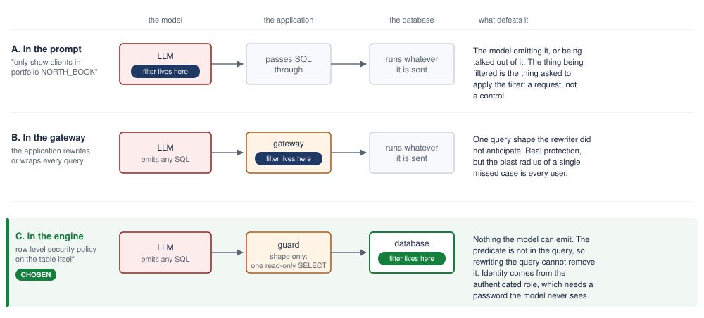

**What it shows:** the same request path three times, with the filter in a
different place, and what defeats it in each case. The lozenge labelled "filter
lives here" moves; everything else is held constant, so the choice is the only
thing changing.

The argument in one line: in the prompt, the thing being filtered is the thing
asked to apply the filter; in the gateway, one unanticipated query shape
defeats it and the blast radius is every user; in the engine, there is nothing
the model can emit, because the predicate is not in the query.

**Read it alongside:** `DECISIONS.md` D009, the Design Decision Record
section 5, and the Entitlements tab of the workbook (which shows what each role
actually sees).

---

## 6. Decision: star schema versus one big table

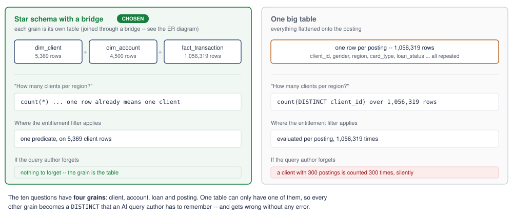

**What it shows:** the same two tasks -- counting clients, and applying the
entitlement filter -- priced against both shapes. One big table is the shape many
text-to-SQL tools prefer because it removes joins, and the figure shows what it
costs instead: every grain other than the posting becomes a `count(DISTINCT
...)` that the query author has to remember, and the entitlement predicate is
evaluated 1,056,319 times rather than 5,369.

The bottom line is the generalisation: the ten questions have four grains, and
one table can only have one of them.

**Read it alongside:** `deliverables/model_explanation.md` ("Alternatives
considered"), the Design Decision Record section 2.

---

## 7. The life of a defect

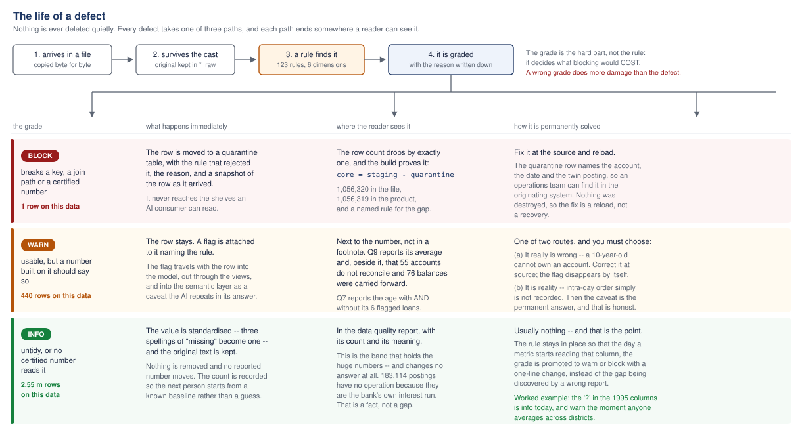

**What it shows:** that nothing is deleted quietly, and -- the part usually left
out -- what *resolving* a defect actually means, which is different for each
grade. A block row is fixed at source and reloaded, and the quarantine entry
holds enough detail for an operations team to find it. A warn row has two
honest endings: correct it at source, or accept that it is reality and keep
the caveat forever. An info row usually needs nothing, and the rule stays in
place so the grade can be promoted the day a metric starts reading that column.

The claim in the header is the one worth arguing with: **a wrong grade does
more damage than the defect.** Blocking the 14 zero-value postings would have
broken 14 balance chains to fix nothing.

**Read it alongside:** `dq/dq_rules.yaml`, `docs/HOW_WE_WORKED_SIMPLY.md`.

---

## 8. Every defect found, and what would solve it

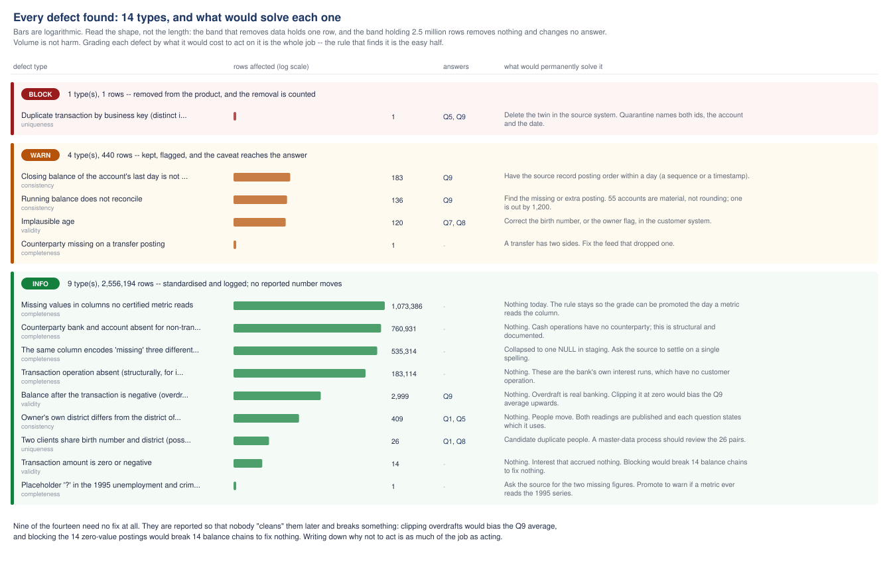

**What it shows:** all fourteen defect types at once, on a log scale, with the
questions each touches and the remedy for each. The shape is the point:
**volume and harm run in opposite directions here.** The red band holds one row
and changes two answers; the green band holds 2,556,535 rows and changes none.

Nine of the fourteen need no fix at all, and they are reported precisely so
that nobody "cleans" them later -- clipping overdrafts would bias the Q9
average upwards, and blocking the zero-value postings would break balance
chains. Writing down *why not to act* is as much of the job as acting.

**This figure is generated** from `deliverables/defects.csv` by
`scripts/make_defect_catalogue.py`, so it cannot drift from the data. Only the
remedy column is held in the script, because a remedy is a judgement and
belongs with a person. A defect type with no recorded remedy renders as a
visible gap rather than a silent blank.

---

## 9. The whole proof of concept, in one picture

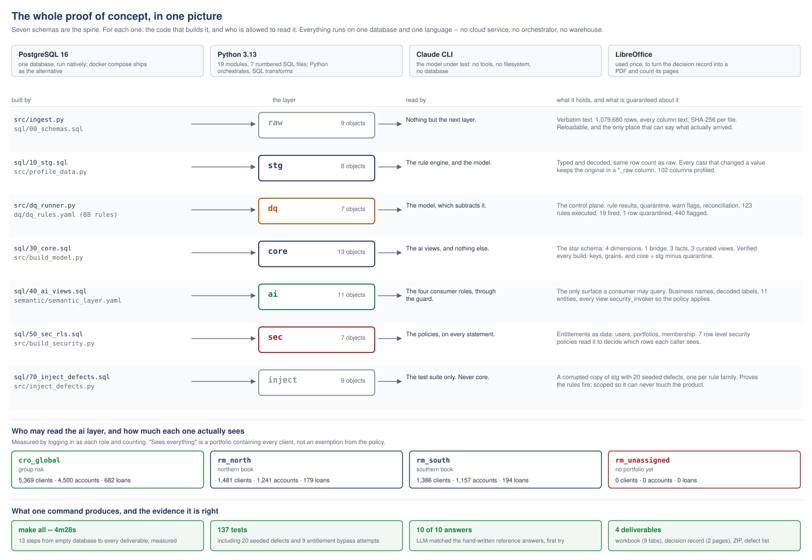

**What it shows:** everything that was stood up, arranged as *for each layer,
the code that builds it and who is allowed to read it*. Seven schemas are the
spine. Around them: what it runs on (one database, one language, no cloud
service and no orchestrator), who may read the consumer layer and how many rows
each of them actually sees, and what one command produces.

The four consumer boxes are measured, not described -- produced by logging in
as each role and counting. `rm_unassigned` seeing **0** is the one to point at:
a badly built system defaults to showing everything.

---

## 10. What `make all` actually does

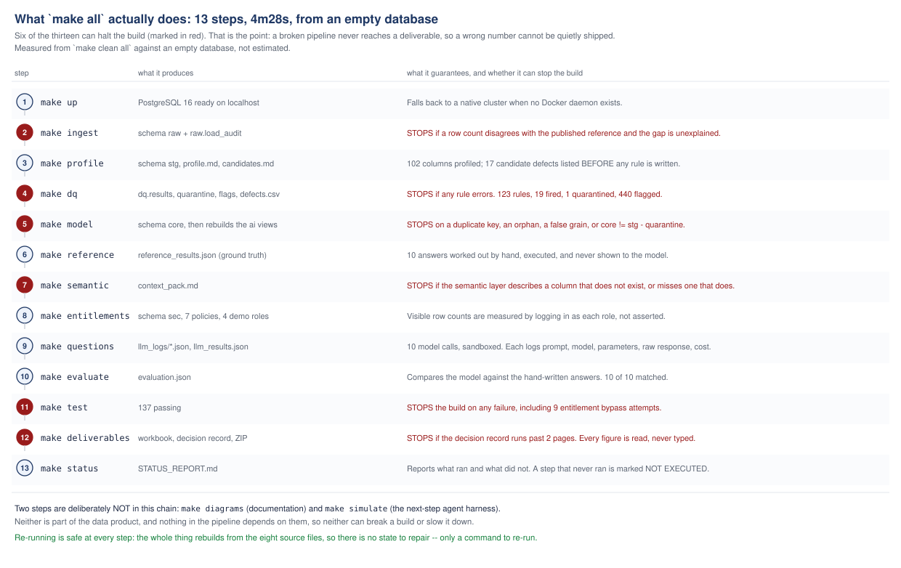

**What it shows:** the thirteen steps in order, what each produces, and -- marked
in red -- the six that can **halt** the build. That is the mechanism behind the
honesty claim: a wrong row count, a broken key, a false grain, a semantic layer
that has drifted, a failing test or a decision record over two pages each stop
the pipeline before a deliverable is written.

It also shows what is deliberately *not* in the chain: the diagram renderer and
the agent simulation. Neither is part of the data product, so neither can break
a build.

---

## 11. Who may reach whose data, and why

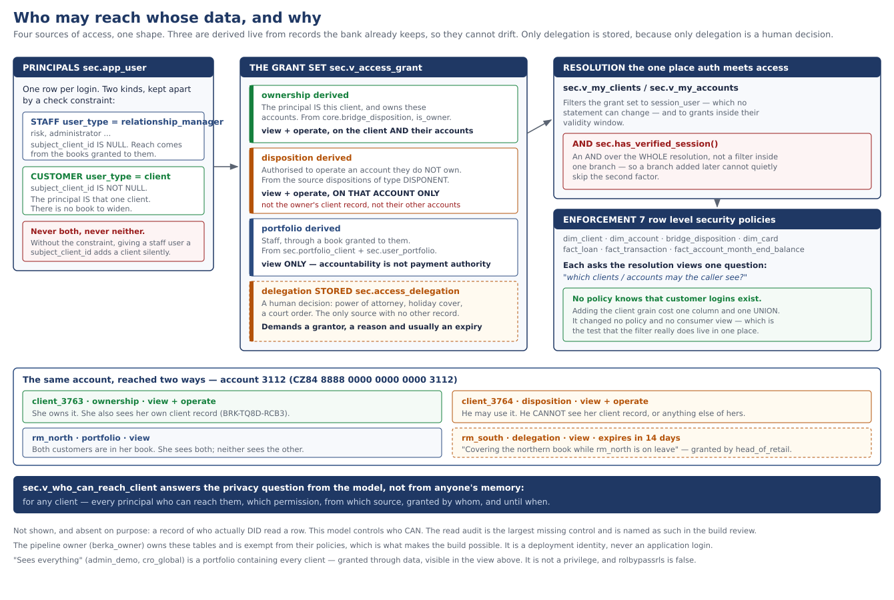

**What it shows:** the whole authorisation model on one page. Two kinds of
principal (staff, who *hold* a book; customers, who *are* a client), four
sources of access, the single place they resolve, and the seven policies that
enforce the result.

Three things to look for. **`disposition` is granted over the account and not
over the person** -- being authorised to use someone's account is not
authorisation to read them, and the panel at the foot shows the same account
reached four different ways. **`portfolio` grants `view` only**, because
accountability for a client is not authority to move their money. And **three
of the four sources are derived live** rather than stored, which was a
correction: the first version materialised them and a test caught a portfolio
grant that did nothing until the next rebuild.

The band at the bottom is the point of the whole model:
`sec.v_who_can_reach_client` answers *"who can see this customer?"* from the
data rather than from anyone's memory.

---

## 12. Two steps to a login, and what each one stops

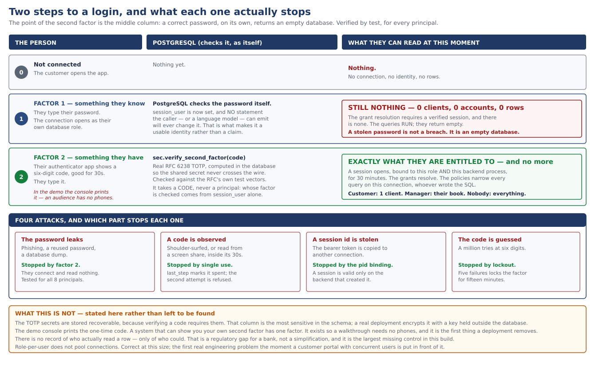

**What it shows:** the login as three moments, and -- in the right-hand column
-- what the person can read at each. The middle row is the claim worth testing:
**a correct password, on its own, returns an empty database.** Not an error;
the queries run and come back with nothing, because the entitlements resolve
only for a session that has passed both factors. Asserted for all eight
principals across seven consumer views.

The lower panel maps four attacks to the specific mechanism that stops each:
a leaked password (factor 2), an observed code (single use), a stolen session
(bound to one connection), a guessed code (lockout).

The amber band is deliberate. The TOTP secrets are stored recoverable because
verification requires them, the demo console prints the code so a walkthrough
needs no phones, and there is no record of who actually read a row -- only of
who could. Those are the limits, and a figure that showed only the strengths
would be the wrong figure.

---

## Regenerating

```
make diagrams
```

Renders every `.mmd` to SVG and PNG with mermaid-cli, regenerates the defect
catalogue from `defects.csv`, and rasterises the hand-authored SVGs to PNG with
the bundled Chromium. It needs `npx` and a Chromium binary and is **not** part
of `make all`: the diagrams are committed, and no part of the data pipeline
depends on them.

| figure | source | kind |
|---|---|---|
| 1-4 | `*.mmd` | Mermaid, rendered |
| 5-6, 9-10 | `*.svg` | hand-authored, rasterised to PNG for slides |
| 7 | `*.svg` | hand-authored |
| 8 | `scripts/make_defect_catalogue.py` | **generated from the data** |
